Report No: 2 Report For 28-Jun-21

## Daily Drilling Report

Well ID:

#### Geothermal Resource Group, Inc.

Forge 78B-32 Well Name: 78B-32

Field: UTAHFORGE Sect: 32 Town: 26 Rng: 9W County: Beaver State: UT

Pers/Hrs: Operator: 3 / 36 Contractor: 14 / 168 Service: 4 / 48 Other: 3 / 36 Total: 24 / 288

Drilling Days (act./plan): 2/21 Flat Days (act./plan): 0/9 Total Days (act./plan): 2/30

Steve Caldwell , Justin Bristol

Wellbore: Original Wellbore

Last BOP Test:

30.40

28-Jun-21

RKB Elevation (ft):

Spud Date:

11.750 at 3,300 16.000 at 416

2

Frontier Rig 16

Next Casing: Last Casing:

Days On Location:

Rig:

73.25 293 / 4.0

Average ROP (ft/hr): Hole Made (ft) / Hrs:

Vertical Depth (ft):

Measured Depth (ft): 421 Operator: University of Utah

Proposed TD (ft): 9500

Working Interest:

Daily Cost / Mud (\$): --- AFE No. AFE (\$) Actual (\$)

--- --- --- --- --- ---

--- --- Totals: Well Cost (\$):

Current Operations: Testing out choke manifold at report time.

Planned Operations: Test casing along with BOPE.

Pick up 8" drill collars. Trip in the hole with tri-cone bit.

Drill out shoe track and 10 ft of new formation to perform LOT

Pull out of the hole and lay down tricone bit

Make up 14 3/4" BHA with PDC and continue drilling 14 3/4" section.

Toolpusher:

Wellsite Supervisors: Virgil Welch , Brian Gresham Tel No.: 7132807438

---

Next BOP Test:

28-Jun-21 Job Reference RKB (ft):

19-Jul-21

Safety Summary: No incidents or events reported. Conducted BOP Test, Crown Check, Safety Meeting.

|       |       |         |            |        | Operations Summary                                                                                           |
|-------|-------|---------|------------|--------|--------------------------------------------------------------------------------------------------------------|
| From  | To    | Elapsed | End MD(ft) | Code   | Operations Description Non-Prod                                                                              |
| 0:00  | 1:00  | 1.00    | 128        | 3-34-3 | Make up 22" surface hole assembly.                                                                           |
| 1:00  | 1:30  | 0.50    | 128        | 03-051 | Filled pipe and hole.                                                                                        |
| 1:30  | 5:00  | 3.50    | 421        | 03-021 | Drilled 22" hole from 128' to 421'.                                                                          |
| 5:00  | 5:30  | 0.50    | 421        | 03-051 | Circulated well bore clean.                                                                                  |
| 5:30  | 6:00  | 0.50    | 421        | 3-27   | Wiped hole f/ 421' t/ 100' with no issues. No fill on bottom.                                                |
| 6:00  | 6:30  | 0.50    | 421        | 3-6-2  | Pull out of the hole f/ 421'                                                                                 |
| 6:30  | 7:00  | 0.50    | 421        | 3-34-4 | Lay down NMDC and bit                                                                                        |
| 7:00  | 8:00  | 1.00    | 421        | 4-56   | Rig up casing crew.                                                                                          |
| 8:00  | 10:00 | 2.00    | 421        | 4-12-1 | Rigged up and Ran 9 joints of 16" k-55 64# BTC casing (382.89') of total casing.                             |
| 10:00 | 11:00 | 1.00    | 421        | 4-56   | Rig down casing crew                                                                                         |
| 11:00 | 12:30 | 1.50    | 421        | 4-12-1 | Land casing with well head 3' below ground level.                                                            |
| 12:30 | 13:00 | 0.50    | 421        | 5-56   | RIH with stab-in and stab into float collar at 378                                                           |
| 13:00 | 14:30 | 1.50    | 421        | 5-56   | Rig up cement crew                                                                                           |
| 14:30 | 16:00 | 1.50    | 421        | 5-99   | Pressure test to 1500 psi, Pump 20 bbl fresh water, pump 50 bbls of sepiolite, pump check floats CIP @ 16:00 |
| 16:00 | 16:30 | 0.50    | 421        | 5-56   | Rig down cement crew                                                                                         |
| 16:30 | 17:00 | 0.50    | 421        | 5-6-2  | POH with stab-in                                                                                             |
| 17:00 | 0:00  | 7.00    | 421        | 1-14   | Installed BOP as followed. 16” x 20” 2M DSA, 20” 2M spacer spool, 20” 2M x 20” 3M                            |

#### Management Summary

Drilled 22" hole from 128' to 421'. Circulated hole clean. Wiped hole from 421' to 100'.

Pulled out laying down tools.

Rigged up and ran 9 joints of 65 ppf, K-55 16" Buttress casing setting shoe at 416' KB.

Ran in the hole with stab-in tool.

Rigged up Resource cementing and cemented casing in place CIP @ 16:00.

Rigged down Resource cementing. Pulled out of the hole with stab-in tool. Installed 20" BOPE. Nippled up BOPE.

Comments

Good cement to surface.

Daily Drilling Report

Well ID:

#### Geothermal Resource Group, Inc.

Forge 78B-32 Well Name: 78B-32

Field: UTAHFORGE Sect: 32 Town: 26 Rng: 9W County: Beaver State: UT

Report No: 2 Report For 28-Jun-21

## Daily Drilling Report

Well ID:

#### Geothermal Resource Group, Inc.

Forge 78B-32 Well Name: 78B-32

Field: UTAHFORGE Sect: 32 Town: 26 Rng: 9W County: Beaver State: UT

| Report No:                 | 4 Report For 30-Jun-21                                                              |
|----------------------------|-------------------------------------------------------------------------------------|
| Pers/Hrs:                  | Operator: 3 / 36 Contractor: 14 / 168 Service: 4 / 48 Other: 3 / 36 Total: 24 / 288 |
| Drilling Days (act./plan): | 4/21 Flat Days (act./plan): 0/9 Total Days (act./plan): 4/30                        |
|                            | Wellbore: Original Wellbore                                                         |
| Measured Depth (ft):       | 2699                                                                                |
| Operator:                  | University of Utah                                                                  |
| Proposed TD (ft):          | 9500                                                                                |
|                            | AFE No. AFE (\$) Actual (\$)                                                        |
|                            | LOT (lbs/gal): 0.58 Well Cost (\$):                                                 |
| Current Operations:        | Pulled out of the hole from 951' to Surface.                                        |
| Planned Operations:        | Drill 14 3/4" section to casing point.                                              |
| Wellsite Supervisors:      | Virgil Welch , Brian Gresham Tel No.: 7132807438                                    |
|                            | 29-Jun-21 Job Reference RKB (ft):                                                   |
| Safety Summary:            | No incidents or events reported. Conducted Safety Meeting.                          |

## Daily Drilling Report

Well ID:

#### Geothermal Resource Group, Inc.

Forge 78B-32 Well Name: 78B-32

Field: UTAHFORGE Sect: 32 Town: 26 Rng: 9W County: Beaver State: UT

#### Operations Summary

| From  | To    | Elapsed | End MD(ft) | Code   | Operations Description Non-Prod                                                        |
|-------|-------|---------|------------|--------|----------------------------------------------------------------------------------------|
| 0:00  | 3:30  | 3.50    | 433        | 3-34-3 | Picked up 14 3/4" RSS BHA to 433'.                                                     |
| 3:30  | 4:15  | 0.75    | 665        | 3-2-3  | Drilled 14 3/4" hole from 433' to 665' with full returns.                              |
| 4:15  | 4:30  | 0.25    | 665        | 03-051 | Circulated hole clean to rack back HWDP and place 3 stands of 8" drill collars into    |
| 4:30  | 5:30  | 1.00    | 665        | 3-34-3 | Pulled out of the hole from 665' to 389'. Racked back 3 stands of HWDP. Installed 3    |
| 5:30  | 6:00  | 0.50    | 858        | 3-2-3  | Drilled 14 3/4" hole from 665' to 858 with full returns.                               |
| 6:00  | 10:00 | 4.00    | 2,077      | 3-2-3  | Drilled 14-3/4" hole from 858' to 2,077' with full returns.                            |
| 10:00 | 10:30 | 0.50    | 2,077      | SERV   | Serviced rig / torqued saver sub                                                       |
| 10:30 | 11:00 | 0.50    | 2,232      | 3-2-3  | Drilled 14-3/4" hole from 2,077' to 2,232' with full returns.                          |
| 11:00 | 11:30 | 0.50    | 2,232      | REPR   | Rig blacked out/ cleaned #2 generator radiator due to overheating. X                   |
| 11:30 | 12:30 | 1.00    | 2,359      | 3-2-3  | Drilled 14-3/4" hole from 2,232' to 2,359' with full returns.                          |
| 12:30 | 13:30 | 1.00    | 2,359      | REPR   | Rig Repair cleaned #1 generator radiator due to overheating. X                         |
| 13:30 | 14:00 | 0.50    | 2,399      | 3-2-3  | Drilled 14-3/4" hole from 2,359' to 2,399' with full returns.                          |
| 14:00 | 15:30 | 1.50    | 2,399      | REPR   | Rig Repairs cleaned #3 generator radiator due to overheating. X                        |
| 15:30 | 21:15 | 5.75    | 2,399      | 3-2-3  | Drilled 14-3/4" hole from 2,399' to 2,699' with full returns.                          |
| 21:15 | 22:00 | 0.75    | 2,399      | 3-5-1  | Circulate hole clean. Pump 15 bbl slug.                                                |
| 22:00 | 0:00  | 2.00    | 2,399      | 3-6-4  | Pull out of the hole from 2,699' to 951'. Tight hole encountered from 2,351' to 1,799' |

Management Summary

#### Picked up 14 3/4" RSS BHA to 433'.

Drilled 14 3/4" hole from 433' to 665' with full returns.

Circulated hole clean.

Pulled out of the hole from 665' to 389'. Racked back 3 stands of HWDP.

Installed 3 stands of 8" drill collars into the BHA.

Tripped in the hole to 665'.

Drilled 14 3/4" hole from 665' to 2,077' with full returns. Serviced rig.

Drilled 14-3/4" hole from 2,077' to 2,232' with full returns. Circulated while cleaning radiator on gen #2 due to overheating. Drilled 14-3/4" hole from 2,232' to 2,359' with full returns. Circulated while cleaning radiator on gen #1 due to overheating. Drilled 14-3/4" hole from 2,359' to 2,399' with full returns. Circulated while cleaning radiator on gen #3 due to overheating.

Drilled 14-3/4" hole from 2,399' to 2,699' with full returns. Circulated hole clean. Tripped out of the hole to 951'.

#### Comments

BOPE test results emailed DWR (Jim Goddard).

#### Casing/Tubular Information

| Report No: 4 Dens. Vis PV YP Filt.       | % Cake pH/ES Solids Oil Water 30-Jun-21 21:00 at Depth 2,697 ft Mud Pits, Type: Low Solids Non-Dispersed | Mud Information Sand LGS Cl Ca CaCl     | Report For 30-Jun-21 Gels Temp Mud 10s 10m 30m In Out Loss |
|------------------------------------------|----------------------------------------------------------------------------------------------------------|-----------------------------------------|------------------------------------------------------------|
| 9.10 42 14 13                            | 9.4 1 10 9 0                                                                                             | 91 12.5 4.2 800 120 Mud Consumables     | 3 7 11 110 118                                             |
| Item Description                         | Qty.                                                                                                     | Cost Item Description                   | Qty. Cost                                                  |
| Barite - 100#SK                          | 20                                                                                                       | Desco CF - 25#SK                        | 1                                                          |
| DMA - 50#SK                              | 5                                                                                                        | Drispac LV - 50#SK                      | 5                                                          |
| Engineering - EACH                       | 1                                                                                                        | FlowZan - 25#SK                         | 10                                                         |
| Gel - 100#SK                             | 70                                                                                                       | Micro C - 50#SK                         | 50                                                         |
| pallets - OTHER                          | 13                                                                                                       | perdiem - OTHER                         | 1                                                          |
| Trucking - EACH                          | 1                                                                                                        | Bit/BHA/Workstring Information          |                                                            |
|                                          |                                                                                                          | WOB RPM                                 | Press                                                      |
|                                          | This Run                                                                                                 | R.O.P.                                  |                                                            |
| No Run Make Model                        | Diam Dist Hrs                                                                                            | Avg Max Torque                          | Wt Flow                                                    |
|                                          | Depth                                                                                                    |                                         | Mud Pump                                                   |
|                                          | In                                                                                                       |                                         | J. Vel P. Drp HHP JIF                                      |
| 2 1 BAKER GT-C1                          | 14.750 360 166 3                                                                                         | 55.3 1, 40 80 15                        | 9 950 3050 409 1361 754 1829                               |
| Jets: 18 18 18                           | 433 Grade: Cutter: Out:                                                                                  | 1 / 1 Dull: NO / NO                     | Wear: A Brgs: 0 Gge: Pull: BHA                             |
| 3 1 NOV TKC66                            | 14.750 433 2,266 15                                                                                      | 151.1                                   | 9 950 3050 281 645 357 1259                                |
| Jets: 15 15 15 15 16                     | 16 2699 Grade: Cutter: Out:                                                                              | 3 / 1 Dull: LT / CT                     | Wear: N Brgs: X Gge: Pull: PR                              |
| BHA - No. 3 -                            | BIT, OTHER, STAB, MWD, 4 OTHER, MMTR, RR, FLOAT, 2 OTHER, DC, XO, HWDP = 956.61                          | Drilling Parameters                     |                                                            |
| From To Avg                              | Max Avg Max                                                                                              | Max                                     | Max Avg Max (psi)                                          |
|                                          |                                                                                                          | Torque (ft lbs)                         | Flow (gals/min)                                            |
|                                          |                                                                                                          | Avg Avg                                 |                                                            |
| Depth (ft)                               | ROP (ft/hr) WOB (lbs)                                                                                    | RPM                                     | Pressure                                                   |
| 433 2,699                                | 174.3 1,300.0 40 65                                                                                      | 70 120 13                               | 22 950 1,050 3,150                                         |
| Annular Velocity: Drill Collars:         | 197.7 Drill Pipe:                                                                                        | 128.2 Miscellaneous Drilling Parameters |                                                            |
| Hook Loads (lbs): Slow Circulation Data: | Off Bottom Rotate: 125 Pick Up:                                                                          | 150 Slack Off: 100                      | Drag Avg/Max: 10 / 15                                      |
| Pump 1:                                  | 35 spm 95 psi                                                                                            | 45 spm 210 psi                          | 60 spm 375 psi                                             |
| Pump 2:                                  | 95 psi 35 spm                                                                                            | 45 spm 210 psi                          | 60 spm 375 psi                                             |
| Pump 3:                                  | 95 psi 35 spm                                                                                            | 45 spm 210 psi                          | 60 spm 375 psi                                             |
|                                          | Rotating:                                                                                                | Tripping:                               |                                                            |
| Hours on BHA:                            | Since Inspection: 9 Total:                                                                               | 9 Jars: 0                               |                                                            |
|                                          | 9 0                                                                                                      | 3 0                                     |                                                            |
| Hours on Casing/Liner:                   | /                                                                                                        | / Survey Information                    | Wear Bushing Installed                                     |
| Type                                     | Depth Inc. Azimuth                                                                                       | TVD Section                             | N-S E-W D.L.S.                                             |
|                                          |                                                                                                          | Vertical                                | Coordinates                                                |
| Survey                                   | Meas.                                                                                                    | Closure                                 |                                                            |
| MWD                                      | 545.0 0.17 93.9                                                                                          | 545.0 4.8 4.8                           | N 4.8 E 0.2 0.513                                          |
| MWD                                      | 731.0 0.07 271.8                                                                                         | 731.0 4.8 4.8                           | N 4.8 E 0.4 0.129                                          |
| MWD                                      | 822.0 0.12 37.4                                                                                          | 822.0 4.8 4.8                           | N 4.8 E 0.4 0.187                                          |
| MWD                                      | 914.0 0.15 342.6                                                                                         | 914.0 5.0 5.0                           | N 5.0 E 0.4 0.138                                          |
| MWD                                      | 1,005.0 0.47 187.3                                                                                       | 1,005.0 4.8 4.8                         | N 4.8 E 0.3 0.670                                          |
| MWD                                      | 1,101.0 0.19 350.9                                                                                       | 1,101.0 4.5 4.5                         | N 4.5 E 0.3 0.682                                          |

Daily Drilling Report Well ID: Forge 78B-32 Well Name: 78B-32

#### Geothermal Resource Group, Inc.

Field: UTAHFORGE Sect: 32 Town: 26 Rng: 9W County: Beaver State: UT

Report No: 4 Report For 30-Jun-21

## Daily Drilling Report

Well ID:

#### Geothermal Resource Group, Inc.

Forge 78B-32 Well Name: 78B-32

Field: UTAHFORGE Sect: 32 Town: 26 Rng: 9W County: Beaver State: UT

#### Mud Log Information

| From                | Mud Log Information Depth (ft) TVD (ft) Gas (Units) Pore Mud Shale ROP Gas Drilling To From To Avg Max Connect. Exp. Press Dens. Dens. at Depth Trip Shale Sand |
|---------------------|-----------------------------------------------------------------------------------------------------------------------------------------------------------------|
| 0 Formation Name:   | 430 0 430 0 0 9.10                                                                                                                                              |
| Lithology:          | 100% Alluvium                                                                                                                                                   |
| 430 Formation Name: | 2,430 430 2,430 0 0                                                                                                                                             |
| Lithology:          | 100% Alluvium                                                                                                                                                   |
| 2,440               | 2,630 2,430 2,440 0 0                                                                                                                                           |
| Lithology:          | 90% Clay 10% Alluvium                                                                                                                                           |
| Formation Name:     | 60% Clay, 40% Alluvium                                                                                                                                          |
| 2,630               | 2,650 2,440 2,570 0 0                                                                                                                                           |
| Lithology:          | 100% Alluvium                                                                                                                                                   |
| Formation Name:     | 90% Clay 10% Alluvium                                                                                                                                           |
| 2,650               | 2,670 2,570 2,580 0 0                                                                                                                                           |
| Lithology:          | 10-50% Rhyolite 50-90% Alluvium                                                                                                                                 |
| Formation Name:     | 70% Clay, 30% Rhyolite                                                                                                                                          |
| 2,670               | 2,700 2,580 2,640 0 0                                                                                                                                           |
| Lithology:          | 100% Alluvium                                                                                                                                                   |
| Formation Name:     | 90\$ Rhyolite, 10% Clay                                                                                                                                         |

#### Rig Information

Generators overheating. cleaned radiators on all 3 gens. Equipment Problems:

Good. Location Condition:

Transport:

#### Solids Control Information

Screen Sizes:

60 60 60 60 60 60 60 60 60

Top Middle 1 Middle 2

Shaker No 3: Shaker No 2:

Shaker No 1: 60

60 60

Bottom

Bulk Inventory

Item Type Units Beginning Used Received On Hand Net

#### Rig Fuel 6,220 1,624 3,500 8,096 1,876 Water / Fluids Inventory Drill Pipe Inventory Water / Fluids Hauled DP Size Joints Weight Grade Thread DP Size Joints Weight Grade Thread

5" 114 19.5 S-135 4.5IF

#### Safety Information Time Description

Meetings/Drills

First Aid Treatments:

Safety

0 Medical Treatments: 0 Lost Time Incidents: 0 Days Since LTI:

60 Two 30 min Pre tour safety meetings with both crews. Trip hazards, pinch points, Working at heights.

BOP Test Crownamatic Check

#### Weather Information

Sky Condition: Air Temperature: Wind Speed/Dir:

Visibility: Bar. Pressure: Wind Gusts:

Partly Cloudy 75 degF 10 / W

10 29.94 2 Report No: 5 Report For 01-Jul-21

## Daily Drilling Report

Well ID:

#### Geothermal Resource Group, Inc.

Forge 78B-32 Well Name: 78B-32

Field: UTAHFORGE Sect: 32 Town: 26 Rng: 9W County: Beaver State: UT

Drill Pipe Inventory DP Size Joints Weight Grade Thread DP Size Joints Weight Grade Thread

5" 114 19.5 S-135 4.5IF

Safety Information

Meetings/Drills

First Aid Treatments:

Safety

0 Medical Treatments: 0 Lost Time Incidents: 0 Days Since LTI:

Time Description

60 Two 30 min Pre tour safety meetings with both crews. Handling BHA, Tripping pipe, Rigging up and running casing.

BOP Test Crownamatic Check

Weather Information

Sky Condition: Air Temperature: Wind Speed/Dir:

Visibility: Bar. Pressure: Wind Gusts:

Clear 70 degF 6 / NNW

10 29.83 1 Report No: 19 Report For 15-Jul-21

## Daily Drilling Report

Well ID:

#### Geothermal Resource Group, Inc. Forge 78B-32 Well Name: 78B-32

Field: UTAHFORGE Sect: 32 Town: 26 Rng: 9W County: Beaver State: UT

Pers/Hrs: Operator: 3 / 36 Contractor: 14 / 168 Service: 6 / 72 Other: 3 / 36 Total: 26 / 312

Drilling Days (act./plan): 19/21 Flat Days (act./plan): 0/9 Total Days (act./plan): 19/30

Steve Caldwell , Justin Bristol

Wellbore: Original Wellbore

Last BOP Test:

30.40

28-Jun-21

RKB Elevation (ft):

Spud Date:

7.000 at 8,500 11.750 at 2,990

19

Frontier Rig 16

Next Casing: Last Casing:

Days On Location:

Rig:

0.0 0 / 9.5

7611

Average ROP (ft/hr): Hole Made (ft) / Hrs:

Vertical Depth (ft):

Measured Depth (ft): 7613 Operator: University of Utah

Proposed TD (ft): 9500

Working Interest:

Daily Cost / Mud (\$): --- AFE No. AFE (\$) Actual (\$)

--- --- --- --- --- ---

--- --- Totals:

LOT (lbs/gal): 11.70 Well Cost (\$):

Current Operations: Tripped in the hole from 2,613' to 7,072'.

Filled pipe and broke circulation every 1,000'.

Took weight at 7,072'. Work string free with 90k in over-pull. Ream from 7,072' to 7,231'.

Planned Operations: Ream from 7,231' to 7,613' as needed.

Drilled 10-5/8" hole to 8,500'.

Toolpusher:

Wellsite Supervisors: Virgil Welch , Brian Gresham Tel No.: 7132807438

---

Next BOP Test:

03-Jul-21 Job Reference RKB (ft):

24-Jul-21

Safety Summary: No incidents or events reported. Conducted Crown Check, Safety Meeting.

|       |       |         |            |        | Operations Summary                                                        |
|-------|-------|---------|------------|--------|---------------------------------------------------------------------------|
| From  | To    | Elapsed | End MD(ft) | Code   | Operations Description Non-Prod                                           |
| 0:00  | 8:00  | 8.00    | 7,613      | REPR   | Waited on hydraulic hose to arrive. X                                     |
| 8:00  | 13:00 | 5.00    | 7,613      | 3-6-4  | POH from 6,559' to 629'                                                   |
| 13:00 | 16:30 | 3.50    | 7,613      | 3-6-2  | Racked back HWDP along with 8' drill collars. Laid out motor, bit, stabs. |
| 16:30 | 22:30 | 6.00    | 7,613      | 3-34-3 | Picked up new (Bico) motor 1.5 deg, 0.160 rev/gal.                        |
| 22:30 | 23:30 | 1.00    | 7,613      | 3-6-3  | Tripped in the hole from 1,000' to 2,613'.                                |
| 23:30 | 0:00  | 0.50    | 7,613      | SERV   | Serviced rig. Adjusted service loop.                                      |

Management Summary

Waited on hydraulic hose to arrive. Installed new top-drive service link hydraulic hose. Tripped out of the hole from 6,559' to BHA. Racked back HWDP along with 8' drill collars. Laid out motor, bit, stabs. Made up 10-5/8" directional assembly. Tripped in the hole from 1,000' to 2,613'. Serviced rig. Adjusted service loop.

#### Comments

Motor took a high amount of torque to drain 45 kft/lbs. Bit had 3-plugged jets with pieces of rubber from the stator bit was also DBR'ed. Motor Stabilizer was 0.5" under-gauged Stabilizer above the motor was 0.75" under-gauged.

Top Stabilizer was 1.25" under-gauged. Total hours of NPT on report 8.0 HRS Total hours of NPT on Frontier to date 56 HRS.

| Report No: | 28    |         |            |        | Report For 24-Jul-21                                                     |
|------------|-------|---------|------------|--------|--------------------------------------------------------------------------|
| From       | To    | Elapsed | End MD(ft) | Code   | Operations Description Non-Prod                                          |
| 16:15      | 17:00 | 0.75    | 8,545      | 4-12-1 | Run 7", 41#, T-110SS, Tenaris casing from 6,614' to 7,070'.              |
| 17:00      | 17:30 | 0.50    | 8,545      | 4-99   | Performed continuity test on fiber optics at 7,070'.                     |
| 17:30      | 19:00 | 1.50    | 8,545      | 3-5-1  | Circulated bottoms up at 7,106'.                                         |
| 19:00      | 19:45 | 0.75    | 8,545      | 4-12-1 | Run 7", 41#, T-110SS, Tenaris casing from 7,070' to 7,812'.              |
| 19:45      | 20:00 | 0.25    | 8,545      | 4-99   | Performed continuity test on fiber optics at 7,812'.                     |
| 20:00      | 21:15 | 1.25    | 8,545      | 4-12-1 | Ran 7", 41#, T-110SS, Tenaris casing from 7,812' to set depth of 8,508'. |
| 21:15      | 21:30 | 0.25    | 8,545      | 4-99   | Performed continuity test on fiber optics at 8,508'.                     |
| 21:30      | 22:30 | 1.00    | 8,545      | 4-99   | Rigged down CRT tool.                                                    |
| 22:30      | 0:00  | 1.50    | 8,545      | 3-5-1  | Circulated at 16 bbl's per min to cool well bore.                        |

#### Daily Drilling Report Well ID: Forge 78B-32 Well Name: 78B-32

#### Geothermal Resource Group, Inc.

Field: UTAHFORGE Sect: 32 Town: 26 Rng: 9W County: Beaver State: UT

**RECORD 2014/12**

# **GSWA HARVEY 1 WELL COMPLETION AND PRELIMINARY INTERPRETATION REPORT, SOUTHERN PERTH BASIN**

**by AS Millar and J Reeve**

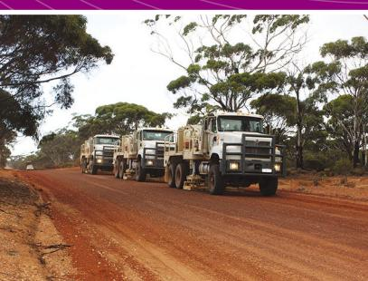

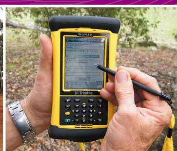

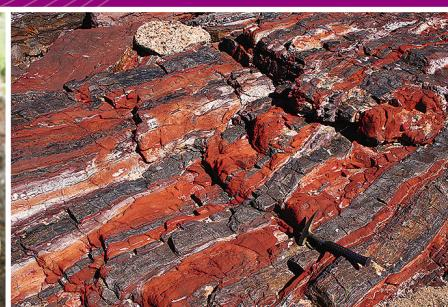

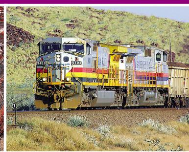

**Record 2014/12**

# **GSWA HARVEY 1 WELL COMPLETION AND PRELIMINARY INTERPRETATION REPORT, SOUTHERN PERTH BASIN**

**compiled by AS Millar and J Reeve\***

**Perth 2014**

**\* Aztech Well Construction Pty Ltd, Colin Street, West Perth WA 6005**

## **Contents**

## **Figures**

| 1. | Location of Harvey 1, L198 Lower Lesueur Seismic Survey lines, petroleum wells, and                                                            |
|----|------------------------------------------------------------------------------------------------------------------------------------------------|
| 2. | Interpreted seismic section (11GA_LL2) from the L198 Lower Lesueur Seismic Survey showing                                                      |
| 3. | MB Century Rig 7 on-site at Harvey 1 ........................................................................................................4 |
| 4. | Generalized stratigraphic column for the Perth Basin ................................................................................6         |
| 5. | Harvey 1 well design and drilling program summary .................................................................................8           |
| 6. | Harvey 1 drilling time curves: predicted versus actual ..............................................................................10        |

## **Tables**

| 1. | Harvey 1 well data record ............................................................................................................................7 |
|----|---------------------------------------------------------------------------------------------------------------------------------------------------------|
| 2. | Prognosed versus actual depth to top of stratigraphic units in Harvey 1 .....................................................9                          |
| 3. | Summary of porosity and permeability analyses for Harvey 1 ..................................................................13                         |
| 4. | Summary result of MICP tests for Harvey 1 ..............................................................................................15              |

## **Appendices\***

- 1. Drilling and formation evaluation program
- 2. Drilling reports
- 3. Geological reports
- 4. Coring reports
- 5. Wireline logging data
- 6. Core plug details
- 7. X-ray diffraction report
- 8. Petrographics report including a list of thin sections
- 9. Porosity and permeability reports
- 10. HyLogger data for individual cores
- 11. Palynology report
- 12. Organic petrography and vitrinite reflectance data

| 1.  | Drilling and formation evaluation program              |
|-----|--------------------------------------------------------|
| 2.  | Drilling reports                                       |
| 3.  | Geological reports                                     |
| 4.  | Coring reports                                         |
| 5.  | Wireline logging data                                  |
| 6.  | Core plug details                                      |
| 7.  | X-ray diffraction report                               |
| 8.  | Petrographics report including a list of thin sections |
| 9.  | Porosity and permeability reports                      |
| 10. | HyLogger data for individual cores                     |
| 11. | Palynology report                                      |
| 12. | Organic petrography and vitrinite reflectance data     |

\* Can be found as separate attachments on the accompanying USB.

# **GSWA Harvey 1 well completion and preliminary interpretation report, southern Perth Basin**

 **by**

**AS Millar and J Reeve\***

# **Abstract**

GSWA Harvey 1 is a stratigraphic well drilled in early 2012 within the southern Perth Basin by the Geological Survey of Western Australia (GSWA). The well is located on a structural feature known as the Harvey Ridge, a poorly defined northwesterly–southeasterly trending basement high observed in seismic data and associated with a high gravity anomaly. The well was completed as part of the South West Hub Carbon Capture and Storage Project, a project jointly funded by the State and Commonwealth Governments, and industry. State funding was from the Royalties for Regions Exploration Incentive Scheme (EIS).

Based upon earlier assessments the area was interpreted to contain a significant thickness of a saline aquifer within the lower Lesueur Sandstone (Wonnerup Member), which could act as a reservoir for storing carbon dioxide. Regionally it is overlain by a potential baffle, the upper Lesueur Sandstone (Yalgorup Member, previously known as the Myalup Member). In turn, the upper Lesueur Sandstone is overlain by the Eneabba Formation, which may also include potential baffle and seal units. Importantly, the area does not contain the Yarragadee Formation, a significant fresh groundwater aquifer in the Perth Basin which might otherwise be at risk of contamination.

Results from the L198 Lower Lesueur Seismic Survey (2011), together with existing seismic data and limited nearby drilling data, were used to plan the location and design of the well to acquire the pre-competitive data needed to fill some of the identified knowledge gaps.

Harvey 1 was spudded on 7 February 2012 and the total depth of 2945 m measured depth below rotary table (MDRT) was reached on 8 March 2012. Following wireline logging, Harvey 1 was plugged with four cement plugs and the rig was released on 26 March 2012. Broadly the predicted stratigraphy was intersected; however, depths of formation boundaries were shallower than predicted by about 120–145 m.

A full mud logging program was completed with cuttings collected at 15 m intervals from 60 to 840 m, and 5 m intervals from 840 to 2945 m. A coring program designed to obtain representative rock samples for analysis was completed and recovered six 100 mm (4") diameter cores over four intervals for a total of 217 m of recovered core. Cored intervals were lithologically logged in detail and 90 representative horizontal and vertical plugs were obtained for analysis.

Standard porosity and permeability measurements were completed on core plugs, and plug trims were used for mercury injection capillary pressure (MICP) testing, X-ray diffraction (XRD) and petrological examination. Following longitudinal cutting, core was run through the GSWA HyLogger to obtain high-resolution photographs and spectral data for mineralogical studies. To assist with sediment provenance studies, a set of unwashed samples was collected for U–Pb detrital zircon geochronology.

Both logging while drilling and end of well wireline logging were used in the well formation evaluation. A single logging suite comprising five runs was completed for the 216 mm (8 ½") hole section at the completion of drilling.

Harvey 1 encountered the expected stratigraphic sequence for the Harvey Ridge area, although each formation was intersected at a shallower depth than predicted. Initial reservoir analysis has indicated that the Wonnerup Member may be suitable for the storage of CO2.

**KEYWORDS**: Jurassic, Triassic, carbon capture and storage, coring, core analysis, geochronology, organic petrology, paleosols, palynology, petrology, reservoir data, spectral analysis, well logging

# **Introduction**

GSWA Harvey 1 (hereafter referred to as Harvey 1) was drilled as part of the South West Hub Carbon Capture and Storage (CCS) Project, Australia's first CCS Flagship project. The South West Hub CCS Project is a government and industry partnership to develop an economically and environmentally sustainable means of reducing carbon dioxide (CO2) emissions in the southwest region of Western Australia.

The key stakeholders of the project are as follows:

r \$PNNPOXFBMUI(PWFSONFOUUISPVHIUIF%FQBSUNFOU of Industry r 8" 4UBUF (PWFSONFOU UISPVHI UIF %FQBSUNFOU PG Mines and Petroleum (DMP) r JOEVTUSZUISPVHI B QBSUOFSTIJQ XJUI (SJGàO &OFSHZ Verve Energy, BHP Billiton Worsley Alumina, Premier Coal, Perdaman Chemicals and Fertilisers, and Alcoa Australia r UIF MPDBM DPNNVOJUZ PG TPVUIXFTUFSO 8FTUFSO Australia.

Additional information on Australian CSS projects may be obtained from the Geoscience Australia (GA) website <www.ga.gov.au/scientific-topics/energy/ghg> or, for Western Australian projects, from the DMP website <www.dmp.wa.gov.au/ccs>.

The geological structural unit known as the Harvey Ridge was identified in regional studies as having potential for CO2 storage in saline aquifers (Varma et al., 2007, 2014). The area was interpreted to contain a significant thickness of a saline aquifer within the lower Lesueur Sandstone which could act as a reservoir; it is overlain by the upper Lesueur Sandstone which is a potential baffle. The latter is overlain by the Eneabba Formation, which may also include potential baffle and seal units. Importantly, the area does not contain the Yarragadee Formation, a significant fresh groundwater aquifer in the Perth Basin which might otherwise be at risk of contamination.

Early regional studies (Causebrook et al., 2006, Varma et al., 2007, 2014) highlighted the following gaps in available data:

r 5IFSFXBTBMBDLPGDPODMVTJWFFWJEFODFPGBSFHJPOBM seal formation. r 5IFSFXBTHFOFSBMMZQPPSTFJTNJDBOEXFMMDPWFSBHFJO the area. r 5IFSFXBTBQBVDJUZPGNPEFSOQFUSPQIZTJDBMEBUBUP determine the reservoir characteristics of the Lesueur Sandstone.

In March 2011, the Geological Survey of Western Australia (GSWA), a division of DMP, in conjunction with GA, completed a 106 km 2D seismic survey along shire roads (Fig.1). Data from the survey is available from the GA website <www.ga.gov.au/products/servlet/ controller?event=GEOCAT\_DETAILS&catno=74810>.

The results from the 2011 seismic survey and existing seismic data were used to plan a stratigraphic well, Harvey 1, that would provide pre-competitive data. A seismic interpretation of the Harvey area is covered by Zhan (2014). The well was designed to assist in filling some of the identified knowledge gaps, and specifically it would:

r DPOàSNUIFQSFTFODFPGUIFQSFEJDUFETUSBUJHSBQIZ r UFTUUIFQSFTFODFPGBMPXFSATIBMFVOJUJOUIF&OFBCCB Formation r FOBCMFFWBMVBUJPOPGUIFTFBMJOHDBQBDJUZPGUIFTIBMF unit, if present r QSPWJEF GSFTI DPSF TBNQMFT PG CPUI UIF &OFBCCB Formation and Lesueur Sandstone for testing seal capacity, reservoir properties and injectivity capacity r QSPWJEFUIF PQQPSUVOJUZUP BDRVJSF B DPNQSFIFOTJWF suite of modern well evaluation logs r FOBCMF DBMJCSBUJPO PG UIF TFJTNJD EBUB BOE integration into the 3D model for the area r BTTJTUJOUIFQMBOOJOHBOEEFWFMPQNFOUPGGVUVSFCPSF holes and seismic programs for further evaluation of the area.

Harvey 1 is located on private land (Lot 1326) off Riverdale Road, Cookernup (Fig.1). It is about 80 m north of shot point 2450 on the L198 Lower Lesueur Seismic Survey line 11GA\_LL2 (Fig. 2).

The well was not expected to encounter hydrocarbons, but its planned depth (3000 m) and drilling program determined that a drilling rig with full provisions for hydrocarbon exploration drilling contingencies was required. Following a public tender, MB Century was awarded the contract to drill the well using Rig 7. Well design and drilling management was completed by Aztech Well Construction Pty Ltd in conjunction with GSWA.

Harvey 1 was spudded on 7 February 2012, reached a total depth of 2945 m on 9 March, and was plugged and abandoned on 23 March 2012 (Fig. 3). All depths related to the drilling are from the rotary table (MDRT) unless noted.

# **Research**

The main objectives of the well were to acquire data and material to further assess the technical feasibility of storing, and permanently containing up to 6.5 Mt per annum over 40 years of CO2 in a condition referred to as BATVQFSDSJUJDBMQIBTF(48"DPPSEJOBUFEUIFDPMMFDUJPO of material and data from the well and its distribution to institutions and organizations awarded contracts to examine and report on the knowledge acquired from respective projects. These ongoing studies are being coordinated by DMP and Australian National Low Emissions Coal Research and Development (ANLEC

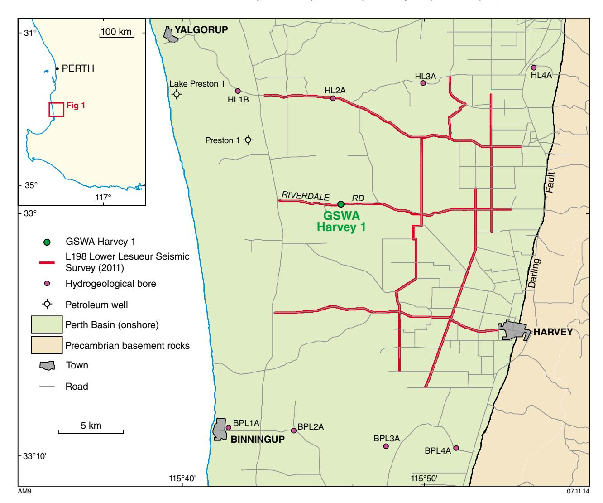

**Figure 1. Location of GSWA Harvey 1, L198 Lower Lesueur Seismic Survey (2011) lines, existing petroleum wells, and hydrogeological bores** 

R&D), and carried out by scientists and engineers from CSIRO, Curtin University and The University of Western Australia. Projects were commissioned to evaluate the data under the following research topics:

- 1. Facies-based rock properties distribution
- 2. Geochemical characterization of gases, fluids and rocks
- 3. Fault seal first-order analysis
- 4. Advanced geophysical data analysis
- 5. Stratigraphic forward modelling
- 6. Static and dynamic reservoir modelling and simulations

Final reports on these projects are being published separately by ANLEC R&D <www.anlecrd.com.au/ publications> and are also available via DMP's online database: Western Australian Petroleum and Geothermal Information Management System (WAPIMS). Results are not included within this report with the exception of preliminary core descriptions, basic core and log analysis. Additional research projects using data from Harvey 1 are ongoing and these will be made available via WAPIMS as they are completed.

Follow-up work planned for the South West Hub CCS Project includes a 3D seismic survey (2014) and several additional wells (2014–15). The objective is to advance UIFTUPSBHFBTTFTTNFOUGSPNBAQSFDPNQFUJUJWFQIBTFUP a point where commercial considerations and decisions are made possible, which would enable the project to become a viable business opportunity for industry.

# **Regional geology**

Harvey 1 was drilled within the southern Perth Basin on the structural feature known as the Harvey Ridge, a poorly defined, northwesterly–southeasterly trending basement high observed in seismic data and associated with a high gravity anomaly (Iasky, 1993, Crostella and Backhouse,

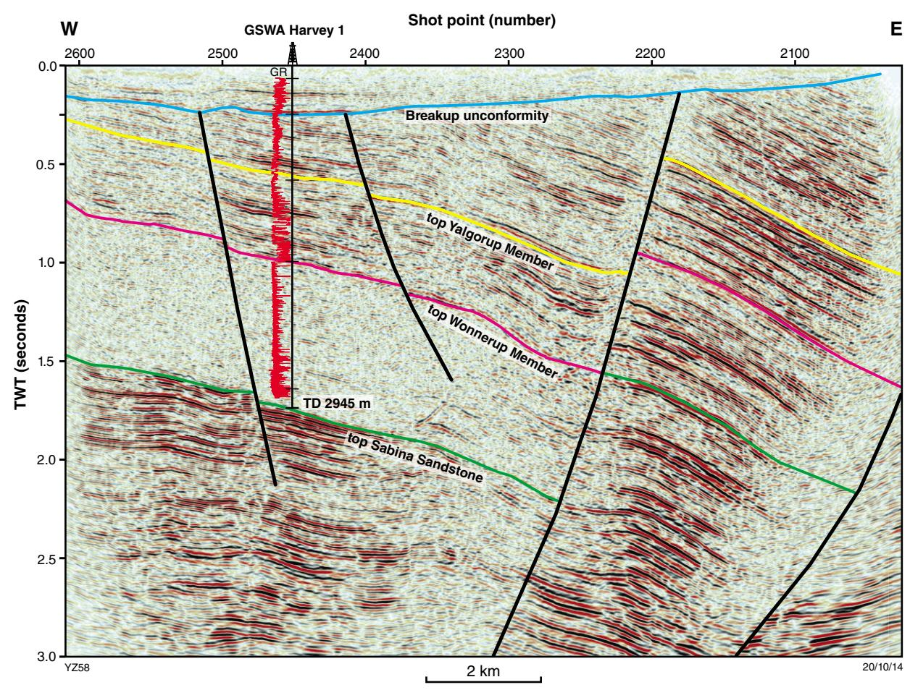

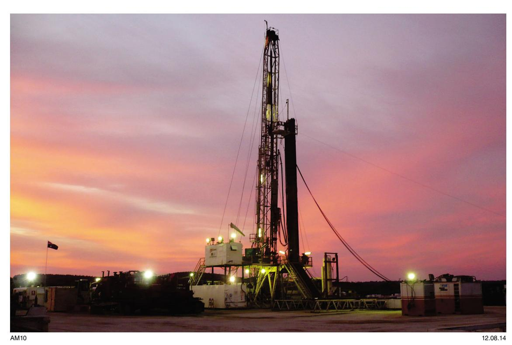

**Figure 2. Interpreted seismic section (11GA\_LL2) from the L198 Lower Lesueur Seismic Survey (2011) showing the position of Harvey 1, and the stratigraphic units it intersected, including the Wonnerup and Yalgorup Members of the Lesueur Sandstone. The seismic line is located along Riverdale Road (Fig. 1). (Zhan, 2014)**

**Figure 3. MB Century Rig 7 on-site at Harvey 1 (photo courtesy of Mark Mitchell)**

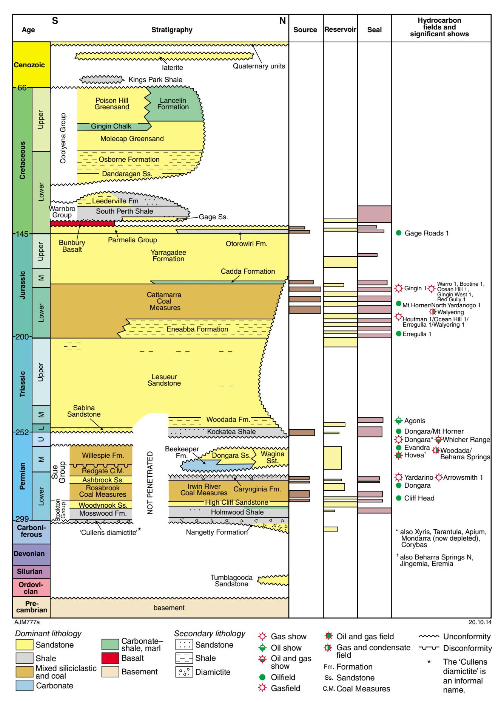

**Figure 4. Generalized stratigraphic column for the Perth Basin** 

# **Table 1. Harvey 1 well data record**

(a) TD = total depth

(b) Estimated final cost includes direct drilling costs and services, consumables, drilling camp, well site supervision, office support and HSE, insurances, site preparation and rehabilitation, geological and logging services and reporting, and laboratory costs.

(c) PIT = Pressure integrity test

(d) SG EMW = Specific gravity, equivalent mud weight

| Formation name Undifferentiated     | MDRT(a) | Prognosed depth to top of unit (m) TVDSS(b) | Thickness | MDRT  | TVDSS    | Actual depth to top of unit (m) High/low(c) | Difference | Thickness |
|-------------------------------------|---------|---------------------------------------------|-----------|-------|----------|---------------------------------------------|------------|-----------|
| Quaternary Leederville              | 5       | 19                                          | 26        | 5.38  | 19.1     | –                                           | –          | 47.6      |
| Formation Eneabba                   | 31      | -7                                          | 244       | 53    | -28.5    | Low                                         | -22        | 203.6     |
| Formation Eneabba                   | 275     | -251                                        | 495       | 249   | -224.5   | High                                        | 26         | 375       |
| Formation, ‘basal shale’(d) Lesueur | 770     | -746                                        | 65        | 624   | -599.5   | High                                        | 146        | 76        |
| Sandstone                           | 835     | -811                                        | 2 110     | 700   | -675.5   | High                                        | 135        | 2 195     |
| Yalgorup Member Wonnerup            | 835     | -811                                        | 697       | 700   | -675.5   | High                                        | 135        | 678       |
| Member                              | 1 532   | -1 508                                      | 1 413     | 1 378 | -1 353.5 | High                                        | 154        | 1 517     |
| Sabina Sandstone Dry hole, total    | 2 945   | -2 921                                      | 50        | 2 895 | -2 870.5 | High                                        | 50         | 50        |
| depth                               | 2 995   | -2 971                                      | –         | 2 945 | -2 920.5 | –                                           | –          | –         |

**Table 2. Prognosed versus actual depth to top of stratigraphic units in Harvey 1**

r OBUVSBMHBNNBCFUXFFOBOEN r TPOJD CFUXFFOBOEN r TIBMMPXBOEEFFQSFTJTUJWJUZCFUXFFOBOEN r GPSNBUJPOCVMLEFOTJUZCFUXFFOBOEN r DPNQFOTBUFEOFVUSPOQPSPTJUZCFUXFFOBOEN r TQPOUBOFPVTQPUFOUJBMCFUXFFOBOEN r CPSFIPMFUFNQFSBUVSFCFUXFFOBOEN

Alongside the wireline logs are displayed the cored intervals, biostratigraphy and vitrinite reflectance samples, a graphic mud log and a summary of abbreviated lithological descriptions directly from the mudlog.

The full wireline log suite is available to be downloaded from WAPIMS via DMP's web page and PDF versions of the logs are presented in Appendix 3. A graphic core log completed by the research group at Curtin University is included as Plate 2.

# **Daily reports**

Daily reports for the rig move and drilling operations are contained in Appendix 2 and daily geological reports in Appendix 3.

# **Mud logging**

A full mud logging program was completed by Baker Hughes INTEQ. Multiple sets of ditch cuttings were collected as outlined in the drilling and formation evaluation program (Appendix 1) and the mud logging report (Appendix 3). Cuttings were collected at 15 m intervals from 60 to 840 m, and 5 m intervals from 840 to 2945 m. An additional set of samples was collected for geochronology analysis by GA. The full mud logging and drilling report can be found in Appendix 3 along with lithological descriptions completed by the wellsite geologists.

# **Conventional coring operations**

The original design of the program was to cut four core intervals to obtain representative material for geological, reservoir and seal testing. The first core was planned to sample an interpreted fine-grained unit at the base of the Eneabba Formation, as intersected in Lake Preston 1 and Pinjarra 1, and include a section of the upper Lesueur Sandstone below about 788 m. The second core was planned within the upper Lesueur Sandstone at about 1450 m, the third within the lower Lesueur Sandstone at about 2200 m and the fourth towards the base of the lower Lesueur Sandstone at about 2870 m.

The interpreted basal shale of the Eneabba Formation was intersected in the openhole section of the well, between about 625 and 704 m, and therefore not cored. The coring program was subsequently modified to obtain representative rock samples for analysis from the remainder of the well. Six cores covering four intervals were cut and recovered from Harvey 1; the depths are listed in Table 1.

Halliburton completed all coring operations. Once the core was pulled to the surface, a standard set of handling procedures was followed for each core:

**NOTES:** (a) MDRT = measured depth rotary table

(b) TVDSS = true vertical depth subsea

(c) High/low = higher/lower than expected elevation

(d) The 'basal shale' is an informal unit of the Eneabba Formation

| and type(a) Plug number 1H 2H | Depth (m) 897.63 898.47 | Grain density (g/cc) 2.65 2.65 | Porosity 800 (%)(b) 23.60 25.12 | Permeability 800 (mD)(b) 918.17 937.69 | Porosity 4300 (%)(b) – – | Permeability 4300 (mD)(b) – – | Comment Friable sample Friable sample | GSWA sample numbers 206601 206602 |
|-------------------------------|-------------------------|--------------------------------|---------------------------------|----------------------------------------|--------------------------|-------------------------------|---------------------------------------|-----------------------------------|
| 3H                            | 903.62                  | 2.65                           | 17.64                           | 10.26                                  | 17.01                    | 9.02                          | –                                     | 206603                            |
| 4V                            | 904.00                  | 2.65                           | 21.85                           | 47.68                                  | 21.12                    | 40.03                         | –                                     | 206604                            |
| 5H                            | 905.71                  | 2.65                           | 24.56                           | 1 047.82                               | 23.91                    | 936.55                        | –                                     | 206605                            |
| 6H                            | 906.93                  | 2.67                           | 20.03                           | 3.77                                   | 19.86                    | 3.25                          | –                                     | 206606                            |
| 7V                            | 907.00                  | 2.68                           | 19.87                           | 0.89                                   | 18.65                    | 0.77                          | –                                     | 206607                            |
| 8H                            | 909.17                  | 2.64                           | 20.59                           | 42.75                                  | 20.11                    | 36.55                         | –                                     | 206608                            |
| 9H                            | 911.53                  | 2.64                           | 25.66                           | –                                      | –                        | –                             | Friable sample                        |                                   |
| 10H                           | 913.83                  | 2.64                           | 24.87                           | –                                      | –                        | –                             | Friable sample                        |                                   |
| 12H                           | 915.45                  | 2.67                           | 20.12                           | 19.45                                  | 19.69                    | 17.71                         | –                                     | 206612                            |
| 13H                           | 917.57                  | 2.64                           | 21.74                           | 1 164.54                               | –                        | –                             | Friable sample                        |                                   |
| 14H                           | 919.16                  | 2.66                           | 24.62                           | 1 253.55                               | 23.55                    | 912.54                        | –                                     | 206614                            |
| 15V                           | 920.00                  | 2.66                           | 20.29                           | 6.29                                   | 19.54                    | 4.43                          | –                                     | 206615                            |
| 16H                           | 920.56                  | 2.66                           | 19.33                           | 5.15                                   | 18.89                    | 4.67                          | –                                     | 206616                            |
| 17H                           | 922.42                  | 2.65                           | 18.19                           | 17.56                                  | 17.80                    | 16.15                         | –                                     | 206617                            |
| 18V                           | 923.00                  | 2.65                           | 24.55                           | 1 037.89                               | –                        | –                             | Friable sample                        |                                   |
| 19H                           | 923.23                  | 2.66                           | 23.17                           | 798.66                                 | 22.66                    | 751.01                        | –                                     | 206619                            |
| 20H                           | 925.84                  | 2.66                           | 21.76                           | 156.33                                 | 21.02                    | 132.05                        | –                                     | 206620                            |
| 21H                           | 926.00                  | 2.65                           | 24.09                           | 837.20                                 | –                        | –                             | Friable sample                        |                                   |
| 22H                           | 927.61                  | 2.65                           | 24.33                           | 964.14                                 | 22.24                    | 789.52                        | –                                     | 206622                            |
| 23H                           | 929.30                  | 2.65                           | 24.93                           | 1 573.23                               | –                        | –                             | Friable sample                        |                                   |
| 24H                           | 930.71                  | 2.65                           | 18.37                           | 2.99                                   | 17.18                    | 2.66                          | –                                     | 206624                            |
| 25V                           | 930.84                  | 2.65                           | 18.87                           | 3.45                                   | 18.12                    | 3.03                          | –                                     | 206625                            |
| 26H                           | 1 266.21                | 2.65                           | 17.65                           | 11.40                                  | 17.04                    | 8.16                          | –                                     | 206626                            |
| 27H                           | 1 271.95                | 2.65                           | 24.66                           | –                                      | –                        | –                             | Friable sample                        |                                   |
| 28H                           | 1 273.89                | 2.65                           | 15.01                           | 0.72                                   | 14.39                    | 0.41                          | –                                     | 206628                            |
| 34H                           | 1 323.53                | 2.63                           | –                               | –                                      | –                        | –                             | Irregular plug not suitable           |                                   |
| 35H                           | 1 323.93                | 2.65                           | 18.50                           | 12.40                                  | 17.77                    | 8.63                          | –                                     | 206635                            |
| 36V                           | 1 324.00                | 2.65                           | 18.34                           | 25.83                                  | 17.04                    | 17.52                         | –                                     | 206636                            |
| 37H                           | 1 325.83                | 2.66                           | 18.37                           | 38.19                                  | 17.40                    | 34.50                         | –                                     | 206637                            |
| 38H                           | 1 329.94                | 2.75                           | 6.70                            | < 0.01                                 | 6.57                     | < 0.01                        | –                                     | 206638                            |
| 40H                           | 1 331.05                | 2.66                           | 13.95                           | 6.62                                   | 12.87                    | 4.95                          | –                                     | 206640                            |
| 41H                           | 1 331.55                | 2.65                           | 18.37                           | 77.19                                  | 17.78                    | 66.32                         | –                                     | 206641                            |
| 42H                           | 1 337.41                | 2.68                           | 10.25                           | 0.07                                   | 9.93                     | < 0.01                        | –                                     | 206642                            |
| 43H                           | 1 342.60                | 2.65                           | –                               | –                                      | –                        | –                             | Irregular plug not suitable           |                                   |
| 44H                           | 1 343.61                | 2.68                           | 13.24                           | 0.52                                   | 12.62                    | 0.07                          | –                                     | 206644                            |
| 45H                           | 1 897.66                | 2.65                           | 15.51                           | 136.82                                 | 15.07                    | 128.58                        | –                                     | 206645                            |
| 46V                           | 1 897.91                | 2.65                           | 16.05                           | 215.01                                 | 15.34                    | 194.35                        | –                                     | 206646                            |
| 47H                           | 1 901.61                | 2.65                           | 16.35                           | 578.67                                 | 15.86                    | 527.89                        | –                                     | 206647                            |

**Table 3. Summary of porosity and permeability analyses for Harvey 1**

| and type(a) Plug number | Depth (m) | Grain density (g/cc) | Porosity 800 (%)(b) | Permeability 800 (mD)(b) | Porosity 4300 (%)(b) | Permeability 4300 (mD)(b) | Comment GSWA sample numbers |
|-------------------------|-----------|----------------------|---------------------|--------------------------|----------------------|---------------------------|-----------------------------|
| 48V                     | 1 902.92  | 2.65                 | 13.92               | 7.28                     | 13.37                | 5.89                      | – 206648                    |
| 49H                     | 1 904.70  | 2.65                 | 14.92               | 41.62                    | 14.53                | 37.44                     | – 206649                    |
| 50H                     | 1 908.71  | 2.64                 | 13.56               | 7.77                     | 13.17                | 6.75                      | – 206650                    |
| 51V                     | 1 908.92  | 2.65                 | 18.37               | 77.24                    | 17.66                | 68.13                     | – 206651                    |
| 52V                     | 1 915.00  | 2.65                 | 14.84               | 5.81                     | 14.18                | 4.55                      | – 206652                    |
| 53H                     | 1 916.38  | 2.67                 | 10.94               | 0.44                     | 10.23                | < 0.01                    | – 206653                    |
| 54H                     | 1 919.30  | 2.65                 | 15.54               | 24.37                    | 15.35                | 21.86                     | – 206654                    |
| 55H                     | 1 927.20  | 2.67                 | 15.08               | 26.65                    | 14.62                | 25.54                     | – 206655                    |
| 56H                     | 1 929.40  | 2.66                 | 14.52               | 100.39                   | 14.11                | 93.60                     | – 206656                    |
| 58V                     | 1 930.00  | 2.81                 | 11.56               | < 0.01                   | 11.13                | < 0.01                    | – 206658                    |
| 59V                     | 1 931.00  | 2.67                 | 16.07               | 170.12                   | 15.67                | 156.12                    | – 206659                    |
| 60H                     | 1 935.50  | 2.65                 | 16.33               | 122.38                   | 15.97                | 111.49                    | – 206660                    |
| 61V                     | 1940.00   | 2.72                 | 14.42               | 1.27                     | 13.65                | 0.13                      | – 206661                    |
| 62H                     | 1 940.58  | 2.68                 | 15.46               | 0.34                     | 14.22                | 0.07                      | – 206662                    |
| 63H                     | 2 480.66  | 2.67                 | 12.90               | 9.76                     | 12.37                | 8.73                      | – 206663                    |
| 64V                     | 2 480.91  | 2.65                 | 11.01               | 0.68                     | 10.57                | 0.12                      | – 206664                    |
| 65H                     | 2 485.53  | 2.65                 | 12.36               | 29.98                    | 11.96                | 26.92                     | – 206665                    |
| 66V                     | 2 488.00  | 2.66                 | 8.80                | < 0.01                   | 8.37                 | < 0.01                    | – 206666                    |
| 67H                     | 2 488.14  | 2.69                 | 5.24                | < 0.01                   | 5.04                 | < 0.01                    | – 206667                    |
| 68H                     | 2 491.22  | 2.65                 | 13.02               | 19.78                    | 12.57                | 18.17                     | – 206668                    |
| 69H                     | 2 491.56  | 2.65                 | 13.67               | 343.66                   | 13.13                | 322.90                    | – 206669                    |
| 70H                     | 2 492.34  | 2.81                 | 2.12                | < 0.01                   | 2.01                 | < 0.01                    | – 206670                    |
| 71V                     | 2 495.93  | 2.66                 | 11.33               | 0.43                     | 10.58                | 0.01                      | – 206671                    |
| 72H                     | 2 496.22  | 2.65                 | 12.47               | 40.83                    | 12.10                | 38.13                     | – 206672                    |
| 73H                     | 2 501.29  | 2.65                 | 12.51               | 22.37                    | 12.16                | 20.14                     | – 206673                    |
| 74V                     | 2 503.00  | 2.65                 | 12.13               | 4.13                     | 11.66                | 3.17                      | – 206674                    |
| 75H                     | 2 503.46  | 2.65                 | 13.56               | 231.44                   | 13.30                | 216.08                    | – 206675                    |
| 76H                     | 2 506.55  | 2.73                 | 11.01               | 0.48                     | 10.66                | 0.21                      | – 206676                    |
| 77H                     | 2 508.29  | 2.65                 | 14.96               | 33.67                    | 14.47                | 30.37                     | – 206677                    |
| 78H                     | 2 509.42  | 2.78                 | 2.25                | < 0.01                   | 2.08                 | < 0.01                    | – 206678                    |
| 79V                     | 2 510.00  | 2.66                 | 11.87               | 1.65                     | 11.65                | 1.29                      | – 206679                    |
| 80H                     | 2 510.29  | 2.67                 | 14.24               | 145.09                   | 13.86                | 134.35                    | – 206680                    |
| 81H                     | 2 513.34  | 2.67                 | 11.42               | 3.59                     | 11.02                | 3.03                      | – 206681                    |
| 82H                     | 2 513.53  | 2.67                 | 12.48               | 9.70                     | 11.86                | 7.78                      | – 206682                    |
| 83V                     | 2 516.00  | 2.67                 | 13.83               | 60.40                    | 13.59                | 55.73                     | – 206683                    |
| 84V                     | 2 520.00  | 2.66                 | 10.99               | 3.48                     | 10.70                | 2.37                      | – 206684                    |
| 85H                     | 2 520.44  | 2.65                 | 13.87               | 115.64                   | 13.63                | 107.99                    | – 206685                    |
| 86H                     | 2 523.34  | 2.71                 | 2.36                | < 0.01                   | 2.08                 | < 0.01                    | – 206686                    |
| 87B V                   | 2 525.00  | 2.65                 | 12.23               | 3.79                     | 11.78                | 2.97                      | – 206687                    |
| 88H                     | 2 525.83  | 2.65                 | 12.33               | 5.32                     | 11.86                | 4.68                      | – 206688                    |
| 89H                     | 2 527.38  | 2.65                 | 11.94               | 9.44                     | 11.49                | 7.51                      | – 206689                    |
| 90H                     | 2 529.29  | 2.65                 | 13.98               | 67.70                    | 13.30                | 61.64                     | – 206690                    |

**NOTES:** (a) H = horizontal plug, V = vertical plug

(b) Samples without values were not suitable for determining porosity and permeability

| Sample number(a) | Depth (m) | Corrected Mercury porosity (%) | Mercury/air displacement pressure (psi) | Pore throat distribution Micropores < 0.1 micron (% PV)(b) | Intermediate 0.1-3 micron (% PV) | Macropores > 3 micron (% PV) | Swanson method Brine permeability (mD) | Air permeability (mD) |
|------------------|-----------|--------------------------------|-----------------------------------------|------------------------------------------------------------|----------------------------------|------------------------------|----------------------------------------|-----------------------|
| 1H               | 897.63    | 22.613                         | 1.993                                   | 13.623                                                     | 37.348                           | 49.030                       | 554.154                                | 580.881               |
| 3H               | 903.62    | 20.280                         | 20.300                                  | 26.192                                                     | 69.260                           | 4.547                        | 2.352                                  | 5.799                 |
| 9H               | 911.53    | 24.414                         | 1.364                                   | 13.901                                                     | 33.007                           | 53.091                       | 762.102                                | 759.971               |
| 16H              | 920.56    | 18.440                         | 51.014                                  | 40.431                                                     | 59.569                           | 0.000                        | 0.391                                  | 1.277                 |
| 22H              | 927.61    | 24.927                         | 2.192                                   | 14.290                                                     | 38.202                           | 47.508                       | 313.794                                | 359.568               |
| 26H              | 1 266.21  | 15.657                         | 45.287                                  | 23.132                                                     | 76.868                           | 0.000                        | 2.755                                  | 6.627                 |
| 27H              | 1 271.95  | 21.097                         | 3.880                                   | 6.915                                                      | 25.043                           | 68.042                       | 229.585                                | 276.269               |
| 28H              | 1 273.89  | 16.023                         | 43.234                                  | 31.090                                                     | 68.910                           | 0.000                        | 0.466                                  | 1.482                 |
| 35H              | 1 323.93  | 16.434                         | 10.248                                  | 2.273                                                      | 78.337                           | 19.390                       | 5.882                                  | 12.565                |
| 36H              | 1 324.00  | 20.431                         | 10.245                                  | 10.538                                                     | 45.466                           | 43.997                       | 33.794                                 | 54.897                |
| 38H              | 1 329.94  | 13.163                         | 92.283                                  | 51.886                                                     | 48.114                           | 0.000                        | 0.098                                  | 0.396                 |
| 42H              | 1 337.41  | 14.230                         | 50.107                                  | 46.052                                                     | 53.948                           | 0.000                        | 0.178                                  | 0.657                 |
| 43H              | 1 342.60  | 11.693                         | 44.358                                  | 62.858                                                     | 37.142                           | 0.000                        | 0.080                                  | 0.336                 |
| 44H              | 1 343.61  | 16.475                         | 45.122                                  | 27.873                                                     | 72.127                           | 0.000                        | 0.762                                  | 2.241                 |
| 45H              | 1 897.66  | 13.618                         | 11.294                                  | 17.199                                                     | 50.684                           | 32.117                       | 8.982                                  | 17.955                |
| 46H              | 1 897.91  | 13.279                         | 1.129                                   | 13.772                                                     | 43.204                           | 43.023                       | 50.650                                 | 77.225                |
| 47H              | 1 901.61  | 16.733                         | 2.916                                   | 9.205                                                      | 39.426                           | 51.370                       | 172.229                                | 216.793               |
| 48H              | 1 902.92  | 2.206                          | 41.385                                  | 31.992                                                     | 68.008                           | 0.000                        | 0.011                                  | 0.063                 |
| 53H              | 1 916.38  | 9.965                          | 84.829                                  | 40.249                                                     | 59.751                           | 0.000                        | 0.056                                  | 0.249                 |
| 60H              | 1 935.50  | 16.383                         | 5.717                                   | 12.056                                                     | 54.123                           | 33.821                       | 15.136                                 | 27.883                |
| 62H              | 1 940.58  | 11.725                         | 62.203                                  | 36.559                                                     | 63.441                           | 0.000                        | 0.150                                  | 0.568                 |
| 63H              | 2 480.66  | 11.230                         | 41.279                                  | 21.334                                                     | 78.666                           | 0.000                        | 0.367                                  | 1.210                 |
| 64H              | 2 480.91  | 10.384                         | 14.699                                  | 24.734                                                     | 68.521                           | 6.745                        | 0.380                                  | 1.245                 |
| 69H              | 2 491.56  | 12.536                         | 5.190                                   | 11.139                                                     | 48.126                           | 40.735                       | 29.068                                 | 48.347                |
| 72H              | 2 496.22  | 11.815                         | 6.943                                   | 26.754                                                     | 61.608                           | 11.638                       | 0.897                                  | 2.571                 |
| 75H              | 2 503.46  | 12.336                         | 3.881                                   | 8.682                                                      | 38.776                           | 52.542                       | 59.481                                 | 88.436                |
| 83H              | 2 516.00  | 14.210                         | 6.301                                   | 15.068                                                     | 35.483                           | 49.448                       | 32.197                                 | 52.700                |
| 88H              | 2 525.83  | 9.885                          | 49.901                                  | 31.745                                                     | 68.255                           | 0.000                        | 0.216                                  | 0.773                 |

**Table 4. Summary result of MICP tests for Harvey 1**

The upper Lesueur Sandstone sample (GA 2132432), at 1000 m depth, yields dates between 3262 and 511 Ma. Three age components have been identified; the oldest is Mesoproterozoic (1272–1067 Ma), the second is Mesoproterozoic–Neoproterozoic (1011–866 Ma), and the younger cluster is Neoproterozoic (604–511 Ma). Analyses yielding dates >1300 Ma are dispersed and do not form significant age components.

The Eneabba Formation sample (GA 2132431), at 450 m depth, yields dates between 2681and 515 Ma. The data define two age components; the older is Archean (2681– 2636 Ma) and the younger is Mesoproterozoic (1223–1080 Ma). The remaining results are dispersed (between 2636 and 1223 Ma, and <1080 Ma) and do not form significant age components.

The shallowest sample analysed was from the Leederville Formation (GA 2132430), at 100 m depth. Data are dispersed between 3358 Ma and134 Ma, with two dominant and, arguably, two subordinate age components. The oldest dominant component is Archean (2763– 2571 Ma) and the younger dominant component is Mesoproterozoic (1232–1061 Ma). The older subordinate component is Paleoproterozoic–Mesoproterozoic (1763– 1595 Ma) and the younger is Neoproterozoic (727–683 Ma). The remaining results are dispersed and do not form significant age components.

**NOTES:** (a) H = horizontal plug (b) PV = pore volume

- Iasky, RP 1993, A structural study of the southern Perth Basin, Western Australia: Geological Survey of Western Australia, Report 31, 56p. Iasky, RP and Lockwood, AM 2004, Gravity and magnetic interpretation of the southern Perth Basin, Western Australia: Geological Survey of Western Australia, Record 2004/8, 32p. Jones, DK and Nicholls, J 1966, Pinjarra No. 1 well completion report, Western Australia; Western Australian Petroleum Pty Ltd: Geological Survey of Western Australia, Statutory petroleum exploration report, W237A1 (unpublished). Playford, PE, Cockbain, AE and Low, GH 1976, Geology of the Perth Basin, Western Australia: Geological Survey of Western Australia, Bulletin 124, 311p. Semeniuk, V 1995, New Pleistocene and Holocene stratigraphic units in the Yalgorup Plain area, southern Swan Coastal Plain: Journal of the Royal Society of Western Australia, v. 78, p. 67–79. Union Oil Development Corporation 1972, Wonnerup No 1 well, Western Australia, well completion report; Union Oil Development Corporation: Geological Survey of Western Australia, Statutory petroleum exploration report, W716A2 (unpublished). Varma, S, Dance, T, Underschultz, J, Langford, RP and Dodds, K 2007, Regional study on potential CO2 geosequestration in the Collie Basin and the Perth Basin of Western Australia: Cooperative Research Centre for Greenhouse Gas Technologies, CO2CRC Report RPT07- 0529, 98p. Varma, S, Underschultz, J, Dance, T, Langford, RP, Esterle, J, Dodds, K and VanGent, D 2014, Regional study on potential CO2 geosequestration in the Collie Basin and the southern Perth Basin of Western Australia: Marine and Petroleum Geology, v. 26,
- p. 1255–1273. Young, RJB and Johanson, JN 1973, Lake Preston No. 1 well completion report, Perth Basin; Western Australian Petroleum Pty Ltd: Geological Survey of Western Australia, Statutory petroleum exploration report, W811A2 (unpublished). Zhan, Y 2014, 2D seismic interpretation of the Harvey area, Southern Perth Basin, Western Australia: Geological Survey of Western Australia, Record 2014/7, 25p.

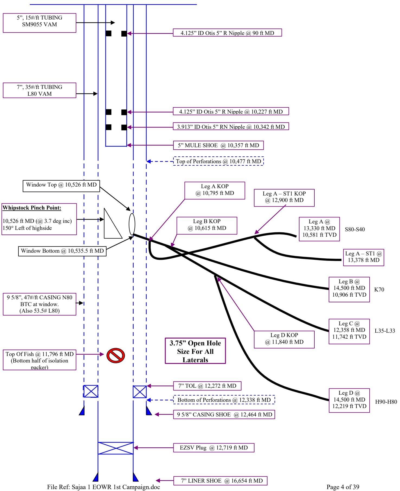

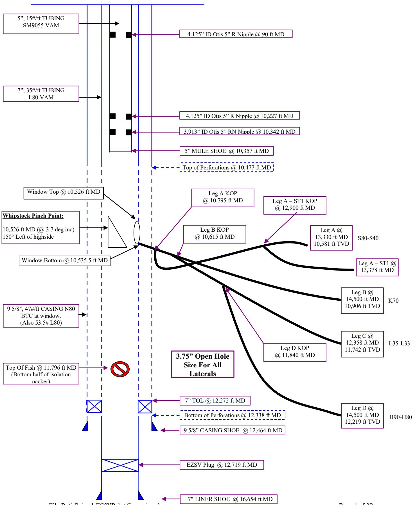

## Wellbore Diagram

foam sweep was pumped to clear out the wellbore and POOH was commenced after the sweep was seen to round the bit. Water rate was reduced to 8 gpm, N2 rate to 1,000 scfm after bottoms up time (10 minutes) to minimize vibration on the BHA. The BHA was pulled to 10,660 ft and a gamma ray survey was conducted (avoiding passing the BHA through the window). The BHA was then picked up and the Leg B KOP trough was time drilled between 10,615 ft – 10,630 ft.

A one hour flow test was conducted on a constant 90/64th inch choke with the BHA in the 7" casing section above the window (at 10,500 ft). Results of the flow test are given below:

## **Results of Leg D flow test with BHA at 10,500 ft and choke at 90/64ths:**

| Time  | 7” FCSGP [Psig] | FWHP [Psig] | BHP [Psia] | Qgas [MMscfd] | Q Condensate [BPD] | Q Water [BPD] | Solids [%] |
|-------|-----------------|-------------|------------|---------------|--------------------|---------------|------------|
| 16:15 | 599             | 134         | 778        | 3.50          | 0                  | 678           | 0          |
| 16:30 | 590             | 132         | 768        | 3.86          | 0                  | 681           | 0          |
| 16:45 | 593             | 160         | 771        | 3.47          | 0                  | 667           | 0          |
| 17:00 | 598             | 125         | 776        | 3.19          | 0                  | 586           | 0          |
| 17:15 | 600             | 155         | 777        | 3.09          | 0                  | 615           | 0          |

The BHA was pulled out of hole and undeployed prior to conducting bi-weekly BOP pressure testing.

# **Drilling the Third leg - Leg B**

BHA #10 was RIH to drill the build section, with a 2.9 deg AKO, and passed through the window at the first attempt. BHP at the window was 1,060 psi with a 7" casing pressure of 821 psi.

Once drilling continued the initial FBHP was at 970 psi with a 7" casing pressure of 740 psi. FBHP was reduced to 940 psi before returns were relatively stable. As we drilled on the FBHP was falling as the charging caused by closing in the well during the BOP testing reduced. Once at 10,770 ft the choke was at a 74 / 64th, and the FBHP was still dropping along with returns. As drilling continued the returns were falling faster than FBHP was i.e. the well was starting to approach balance. The end of the build section was reached at 10,815 ft and the well was shut in on the trip out of the hole.

BHA #11, a kick off assembly comprising 3.75" M09 bit, 2 7/8" M1 ADM motor with 0.7 degree AKO was picked up and RIH. The BHA was oriented to 150 deg Left and passed through window. There was an electrical short in the BHA at 10,800 ft, shortly after opening up well to the BRT. BHA #11 was POOH and undeployed.

BHA #12, a kick off assembly comprising 3.75" M09 bit, 2 7/8" M1 ADM motor with 0.7 degree AKO was picked up and RIH. The BHA passed through the window with no

# **NPT Analysis**

NPT for Sajaa 1 was 13.1% of total time, 11.5% of total cost. The information is broken down in the tables & charts below:

| Totals       | Time [Hours] | Cost        | % of Total Time | % of Total Cost |
|--------------|--------------|-------------|-----------------|-----------------|
| Baker        | 79.0         | \$355,106   | 11.8%           | 9.8%            |
| bp           | 0.0          | \$0         | 0.0%            | 0.0%            |
| GSI          | 0.0          | \$0         | 0.0%            | 0.0%            |
| Halliburton  | 3.5          | \$20,778    | 0.5%            | 0.6%            |
| Schlumberger | 5.2          | \$41,209    | 0.8%            | 1.1%            |
| SEAL         | 0.0          | \$0         | 0.0%            | 0.0%            |
| Undefined    | 0.4          | \$1,413     | 0.1%            | 0.0%            |
| Total NPT    | 88.1         | \$418,506   | 13.1%           | 11.5%           |
| Total Well   | 672.0        | \$3,631,750 |                 |                 |
| Productive   | 583.9        | \$3,213,244 | 86.9%           | 88.5%           |
| Rig Days     | 28.0Days     |             |                 |                 |

Total Well Cost \$3,631,750

Every failure of a BHA was recorded as NPT against Baker (NB: this includes BHI & BOT) as per bp standard procedure, to remove any subjectivity from the appliance of NPT criteria. However, bp considers the use of 2 milling BHA's per window (1 to run Whipstock and one to mill the window) and 2 drilling BHA's per leg as a reasonable technical limit for this project, given the downhole temperatures and drilling fluid pumped. Accordingly, the NPT for BHI using these criteria would be reduced to:

| Totals       | Time [Hours] | Cost        | % of Total Time | % of Total Cost |
|--------------|--------------|-------------|-----------------|-----------------|
| Baker        | 21.1         | \$94,695    | 3.1%            | 2.6%            |
| bp           | 0.0          | \$0         | 0.0%            | 0.0%            |
| GSI          | 0.0          | \$0         | 0.0%            | 0.0%            |
| Halliburton  | 3.5          | \$20,778    | 0.5%            | 0.6%            |
| Schlumberger | 5.2          | \$41,209    | 0.8%            | 1.1%            |
| SEAL         | 0.0          | \$0         | 0.0%            | 0.0%            |
| Undefined    | 0.4          | \$1,413     | 0.1%            | 0.0%            |
| Total NPT    | 30.2         | \$158,095   | 4.5%            | 4.4%            |
| Total Well   | 672.0        | \$3,631,750 |                 |                 |
| Productive   | 641.8        | \$3,473,655 | 95.5%           | 95.6%           |
| Rig Days     | 28.0         | days        |                 |                 |

Total Well Cost \$3,631,750

#### **NPT Time Percentage**

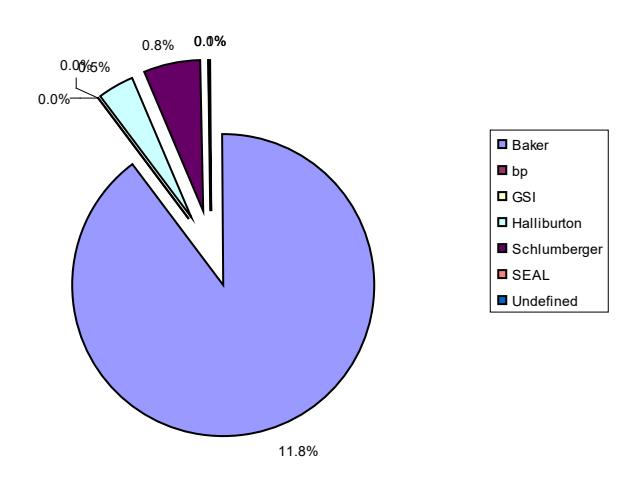

#### **NPT VS Productive Time**

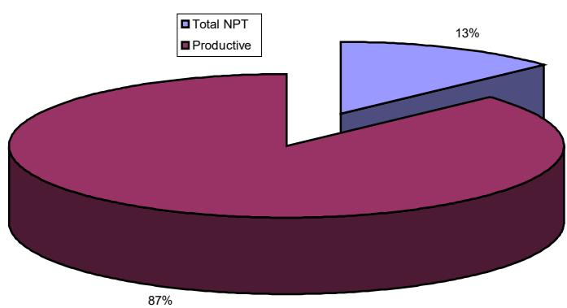

## NPT Time Breakdown:

| BAKER    |                                                |            |           |
|----------|------------------------------------------------|------------|-----------|
| Date     | Time Problem                                   | Daily Cost | NPT cost  |
| 14th Feb | 14.33Short in Whipstock BHA#2                  | \$95,255   | \$56,875  |
| 16-Feb   | 8.67Mill on BHA #5 worn out - replace          | \$96,214   | \$34,757  |
| 17-Feb   | 1.00Mill on BHA #5 worn out - replace (contd.) | \$101,787  | \$4,241   |
| 21-Feb   | 12.10BHA communications problem (BHA # 8)      | \$124,502  | \$62,770  |
| 28-Feb   | 10.43Short in BHA #11                          | \$101,969  | \$44,314  |
| 28-Feb   | 6.60Orienter Failure in BHA #12                | \$101,969  | \$28,041  |
| 29-Feb   | 4.37Orienter Failure in BHA #12 (contd.)       | \$101,969  | \$18,567  |
| 29-Feb   | 7.13Short in BHA # 13                          | \$109,011  | \$32,385  |
| 29-Feb   | 3.47Short in BHA # 13 (contd.)                 | \$109,011  | \$15,761  |
| 29-Feb   | 0.95Orienter Failure in BHA #14                | \$109,011  | \$4,315   |
| 1-Mar    | 9.97Orienter Failure in BHA #14 (contd.)       | \$127,773  | \$53,079  |
| Totals   | 79.02                                          | Dollars    | \$355,106 |

| SLB    |                                                         |                              |          |
|--------|---------------------------------------------------------|------------------------------|----------|
| Date   | Time Problem                                            | Daily Cost                   | NPT cost |
| 13-Feb | 1.58Adjust faulty gooseneck support arm (coil in hole)  | \$245,805                    | \$16,182 |
| 13-Feb | 1.50Replace gooseneck support arm (coil out of hole)    | \$245,805                    | \$15,363 |
| 27-Feb | 1.13                                                    |                              |          |
|        | Leaking new N2 flow meter -                             | no gaskets fitted on Graylok |          |
|        | flanges                                                 | \$105,882                    | \$4,985  |
| 29-Feb | 1.03Flush Power pack radiator with water to unblock it. | \$109,011                    | \$4,678  |
| Totals | 5.24                                                    | Dollars                      | \$41,209 |

| GSI  |      |         |            |          |
|------|------|---------|------------|----------|
| Date | Time | Problem | Daily Cost | NPT cost |
|      |      |         | n/a        | \$0      |
|      |      |         | n/a        | \$0 \$0  |

| HES    |                                                  |            |          |
|--------|--------------------------------------------------|------------|----------|
| Date   | Time Problem                                     | Daily Cost | NPT cost |
| 24-Feb | 3.28Make long wiper & tie in new condensate pump | \$141,268  | \$19,307 |
| 24-Feb | 0.25Condensate caused BHI computer to be reset   | \$141,268  | \$1,472  |
| Totals | 3.53                                             | Dollars    | \$20,778 |

| Date   | Time | Problem                                                   | Daily Cost NPT cost |
|--------|------|-----------------------------------------------------------|---------------------|
| 18-Feb |      | 0.35Problem with crane computer system while undeploying. | \$96,897 \$1,413    |
| Totals |      | 0.35                                                      | Dollars \$1,413     |

#### **Service Company NPT Comparison For Sajaa 3, 15, 7, 16, 4, 32, 17, 42, 5 & 1**

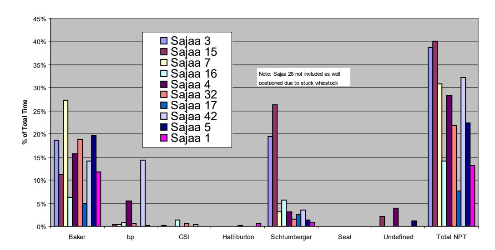

# **Appendices**

# **Appendix 1: HSE Statistics**

## Environmental Totals

37,408 man hours on this well without a DAFWC. 394,832 man hours so far on the project without a DAFWC.

# **Appendix 9: CT Specifications**

A tapered work string with no e-line was used for BHA's # 1 (under-reaming) and BHA's 4-6 (window milling). A tapered e-line string was used for BHA's 2-3 (setting whipstock) and BHA's 7-15 (drilling). This was done to maximize the life of the tapered e-line string. The details of both strings are listed below:

## **String No. PE 10586 (Tapered Work String)**

# Coiled Tubing String Segments

#### **Reel Identification work reel**

Coiled Tubing Material HS-90 Reel Core Diameter 98.000 in Reel Core Width 96.000 in

## **String Identification pe 10586-8jan04**

Total String Length 12345.00 ft CT Total Volume 51.0 bbl

# **Coiled Tubing String Segments**

| Outer Diameter (in) | Nominal Thickness (in) | Minimum Thickness (in) | Segment Length (ft) | Segment Volume (bbl) |
|---------------------|------------------------|------------------------|---------------------|----------------------|
| 2.375               | 0.134                  | 0.128                  | 5065.00             | 21.8                 |
| 2.375               | 0.145                  | 0.138                  | 1415.00             | 6.0                  |
| 2.375               | 0.156                  | 0.148                  | 1225.00             | 5.1                  |
| 2.375               | 0.175                  | 0.167                  | 1610.00             | 6.4                  |
| 2.375               | 0.190                  | 0.183                  | 3030.00             | 11.7                 |

|   |           |       | Company | Well    |                |         |    |
|---|-----------|-------|---------|---------|----------------|---------|----|
| 1 | 11 Feb 04 | BHA 1 | BP      | Sajaa 1 | Scale Milling  | 100.00  | 80 |
| 2 | 15 Feb 04 | BHA 4 | BP      | Sajaa 1 | Window Milling | 100.00  | 80 |
| 3 | 17 Feb 04 | BHA 5 | BP      | Sajaa 1 | Window Milling | 100.000 | 80 |
| 4 | 18 Feb 04 | BHA 6 | BP      | Sajaa 1 | Window Milling | 100.00  | 80 |

# Coiled Tubing Fatigue Plot

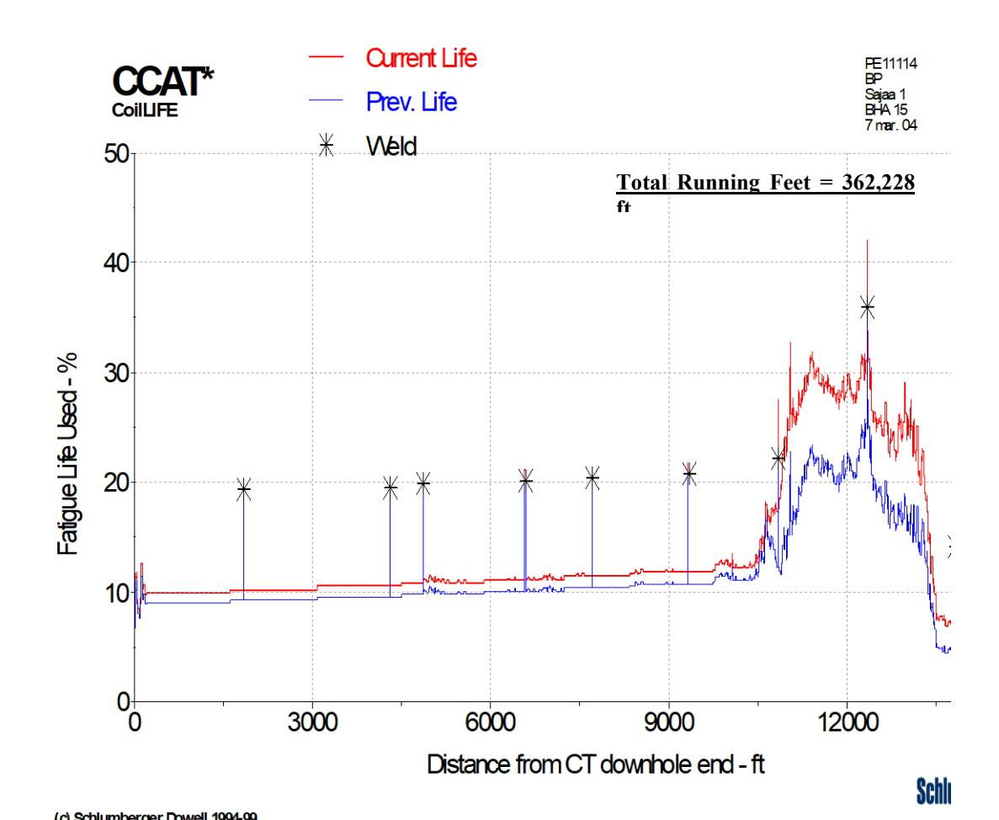

# **Getting to Zero and Beyond: The Path Forward**

*Improving Safety in the Oil and Gas Industry*

**March 2018**

## **Table of Contents**

| 1.0 | Executive Summary...........................................................................................................................         | 1  |
|-----|------------------------------------------------------------------------------------------------------------------------------------------------------|----|
| 2.0 | Introduction........................................................................................................................................ | 3  |
| 3.0 | How Did We Get Here: The Road to Stavanger                                                                                                           | 5  |
| 4.0 | It’s All About Us: Human Factors......................................................................................................               | 8  |
| 5.0 | Achieving a Culture of Perfection Led From the Top......................................................................                             | 17 |
| 6.0 | Where Do We Go From Here? Next Steps                                                                                                                 | 22 |
| 7.0 | Appendices.......................................................................................................................................    | 30 |
|     | 7.1 Acronyms.................................................................................................................................        | 30 |
|     | 7.2 Participant Demographics for SPE Getting to Zero: The Road to Stavanger Sessions...........                                                      | 31 |
|     | 7.3 The ABC Model.......................................................................................................................             | 32 |
|     | 7.4 Afterword                                                                                                                                        | 33 |
|     | 7.5 References................................................................................................................................       | 35 |
|     | 7.6 Author and Contributor Biographies                                                                                                               | 38 |

# **2.0 Introduction**

*For me, the idea is to shun the incremental and go for the leap.* –Jack Welch, Chief Executive Officer of General Electric, 1973–2001

The oil and gas industry was started by visionaries and wildcatters who foresaw a brighter future and were willing to scrap the status quo and take steps to achieve their vision. For the industry to reposition itself for the future today, it needs an injection of the same willingness to cast aside some strongly held legacy beliefs and practices and take the next leap forward—achieving zero harm.

Rod Gutierrez, PhD, Global Leader—Culture and Change Management for DuPont Sustainable Solutions, has written that the concept of zero has encouraged industries to move away from simply minimizing risks through engineering out hazards toward actively engaging people for an overall improvement to workplace health and safety outcomes (Gutierrez 2015):

*But however positive this advancement, it is important to consider what comes next. What if we are to shift our point of reference, so that zero harm was no longer the goal, but rather simply the beginning of sustained workplace health and safety? By reconfiguring the scale that we apply to workplace health and safety, by no longer considering zero as a final objective but rather a starting point, a minimum standard, we allow for the opportunity to initiate comprehensive and meaningful outcomes*.

The concept of zero harm is not a new one in the oil and gas industry, which has for more than two decades set HSE goals that are focused on the reduction of incidents with the ultimate intended outcome that no one be hurt and no releases occur. However, the challenge for decades has been the alignment of industry on an effective pathway to achieve these goals. To attain zero harm, a step change in thinking, performance, and alignment around HSE is required across the industry. 2016 SPE President Nathan Meehan stated, "This trend in performance improvement over the past decade has plateaued. We need a breakthrough" (Meehan 2015).

It is acknowledged that some believe directing attention toward achieving zero harm can lead to a detrimental focus on incidents and injuries that may lead to underreporting of incidents, gaming of statistics, manipulation of incident definitions, and overly aggressive injury case management. Sidney Dekker has argued against zero being a goal. However, his explanation of it as a vision perhaps best illustrates what it can represent (Dekker 2013):

*A zero vision is a commitment. It is a modernist commitment, inspired by Enlightenment thinking, that is driven by the moral appeal of not wanting to do harm and making the world a better place. It is also driven by the modernist belief that progress is always possible, that we can continually improve, always make things better*.

Between 2009 and 2016, SPE facilitated a series of global sessions to develop ideas for the continued improvement of HSE in the industry. These sessions brought together leaders representing diverse disciplines from across the industry, government, and academia to discuss a simple question: How can the oil and gas industry achieve zero harm?

The participants of the SPE sessions identified that achieving and sustaining zero harm relies on the industry's people and the factors that influence the interaction of people with each other, with the facilities Participants prioritized five organizational values that define culture and impact the ability of the industry to achieve an expectation of zero harm **(Fig. 2).**

**Fig. 2—SPE Getting to Zero sessions participant responses to survey question: Select five values that you believe are critical to achieving a safety vision of "getting to zero."**

Participants also identified five obstacles (listed in priority as defined by the participants) that require attention in the near term if the industry is to achieve an expectation of zero harm:

- • Insufficient alignment and application of human factors
- • Misalignment and confusion on the expectation of zero harm
- • Ineffective leadership development
- • Inaccurate identification and management of risk
- • Market pressure and recent industry downturn

Participants overwhelmingly agreed that the evolution of the industry's HSE culture and risk-tolerance maturities were driving forces in the recognition that human factors are pivotal and a required pathway for the industry to achieve an expectation of zero harm.

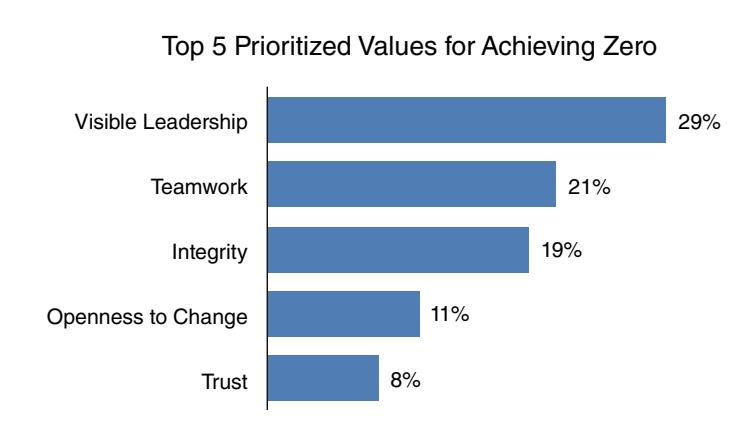

If the oil and gas industry is to achieve the needed step change in culture, risk management, and performance to embrace and realize an expectation of zero harm, it is worthwhile to understand more about human-factor elements **(Fig. 3).** Specifically, how they may be and are being applied across the oil and gas industry and how HROs and other industries changed, learned, and worked together to fulfill the expectation of zero harm in their operations.

**Fig. 3—Human-factors elements.**

## **4.1 Human/Equipment Interaction**

Addressing human/equipment interaction requires mastering three categories:

- • Identification of human actions that are critical to safety
- • Review of legacy-equipment incident data with proper human-factors causal analysis to identify opportunities to improve equipment design
- • Incorporation of error-reducing strategies and questions during risk assessments

Identifying human actions that are critical to safety places emphasis on operating activities that, if not performed in accordance with the procedure, could result in a major loss. The nuclear industry, through the Nuclear Regulatory Commission (NRC), handles this category through their human-factors-engineering (HFE) programs. The "major loss" concern includes damage to the nuclear reactor core. The goal of the programs is to minimize the likelihood of human error and ensure that personnel can detect and recover from any errors that may occur.

The NRC conducts a review for every plant-design application to verify that the applicant has

- • Identified specific important human actions tied to human factors

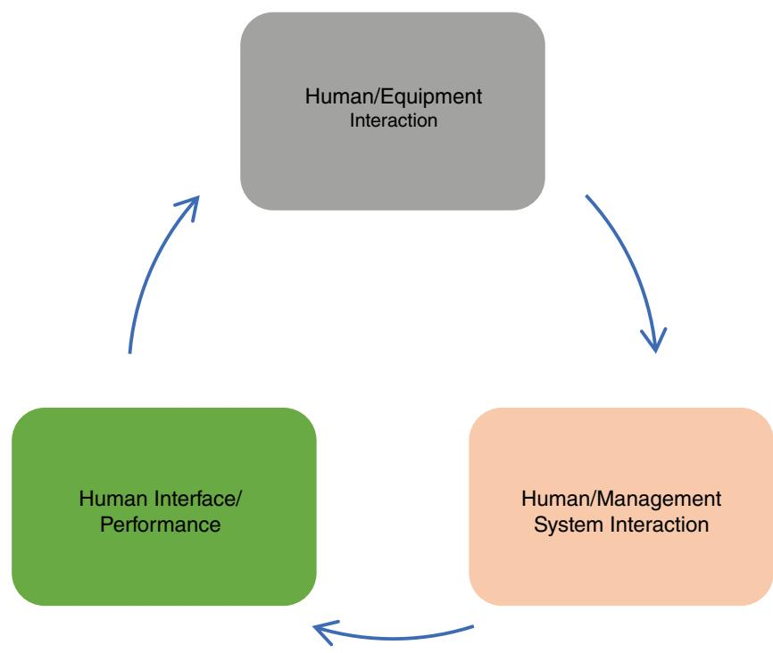

# **5.0 Achieving a Culture of Perfection Led From the Top**

*Oil and gas companies will never be "High Reliability Organizations" if they rely on campaigns to change hearts and minds on the operational frontline. Instead, they must identify the obvious precursors to catastrophe and get serious about eliminating them – led firmly from the top.*

–Andrew Hopkins, 2014

Zero harm as an expectation will require a cultural adjustment for the industry. Patrick Hudson's Safety Culture Maturity Model (Hudson 2001) is a recognized framework used by organizations to assess and understand their culture. For the 2015–16 SPE Getting to Zero sessions, the Hudson model was adapted to evaluate HSE culture and risk tolerance **(Fig. 4).**

**Fig. 4—Culture/risk tolerance adaptation of Hudson's Safety Culture Maturity Model.**

Participants at the SPE Getting to Zero sessions identified that an evolution to a generative mindset is emerging within their companies, for both HSE culture and risk tolerance **(Fig 5).** Specifically,

- • Two-thirds (69%) identified their organizations as having a proactive/generative HSE cultural mindset: 50% proactive/19% generative.
- • Three-quarters (78%) identified their organizations as having a risk-tolerance mindset of being naturally proactive/generative: 72% proactive/6% generative.

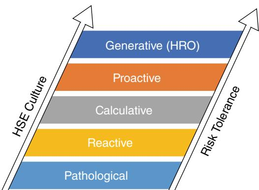

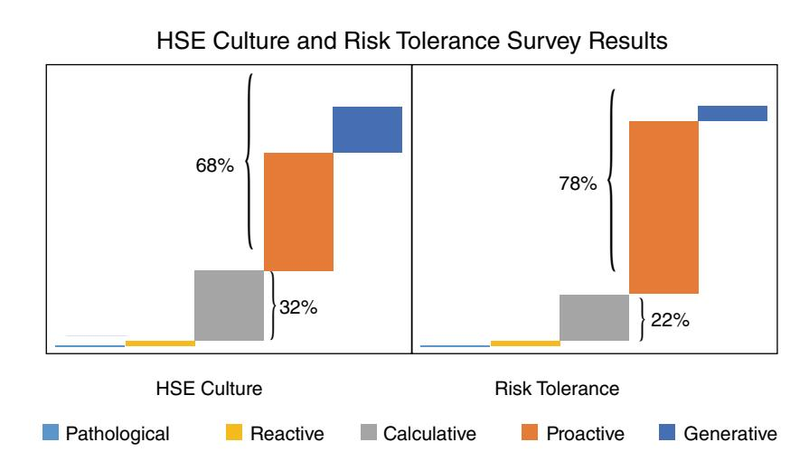

Although the more than 750 session participants represented a diverse cross section of the industry, the authors are not concluding that the survey unequivocally defines where the oil and gas industry is on its evolutionary journey to a generative mindset. Rather, the authors attest that the results represent insight into the industry's desire and the direction in which the industry is moving on attributes that are essential for achieving zero as an expectation.

Also indicative of the culture across the industry of the ability to achieve an expectation of zero harm are the present attention and action that are being given to incidents. As a frame of reference, incidents are categorized as fatalities, lost-time injuries, medical cases, first-aid, high-potential, and near-miss. When asked what level of safety incidents trigger their company's incident analysis and attention, the participants reported the following **(Fig. 6):**

- • More than one-third of the session participants identified that in their organizations all incidents receive analysis and attention regardless of outcome severity.
- • For nearly one-half of the participants, high-potential incidents initiate action in their organizations.
- • The small remainder of participants limit their analysis and attention to traditional incident metrics (that is, fatalities, lost time, medical cases, and first aids).

**Fig. 6—Management of HSE incidents—survey results from SPE Getting to Zero sessions.**

When session participants were queried regarding their company's state of cultural readiness to embrace zero as possible, the results were notable.

- • 2% expressed no desire to pursue, and just 16% cited a present lack of leadership commitment or limitations in their present means to manage HSE as what was holding them back.
- • 33% indicated it may take some time and clarity as to "how" they would embrace zero as possible.
- • Nearly one-half (49%) responded that they are actively working now or are ready to join others in the pursuit.

Most encouraging are the organizational behaviors cited during the SPE Getting to Zero sessions that underpin these positive percentages. More organizations now genuinely believe safety is critical to business success and that their safety systems are essential, using effectiveness methodologies to ensure their efficacy. For

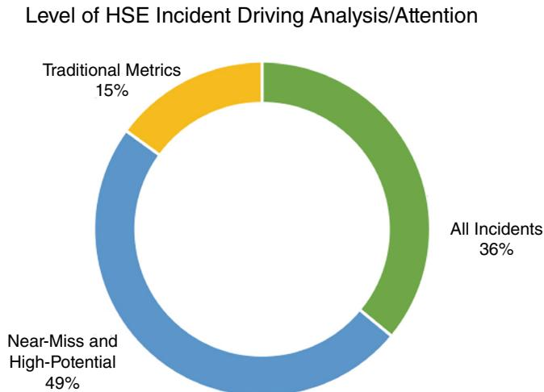

such as resource planning and competencies. We will be able to regularly include human-factors assessments in such things as hazard and operability studies/hazard-identification studies and equivalent tools/ processes so we can identify shortcomings in the understanding of the engineered process. Incident investigations and root-cause analysis can include a common set of human-factors attributes that would allow companies to better understand contributing factors in events that go well beyond the often-cited and yet narrow assessment that someone did not follow process or that the event was caused by operator error.

Industry conferences and technical forums provide the opportunity to further the discussion and share broader ideas and actions started by the industry. Examples of these opportunities include

- • 2014 SPE Workshop Getting to Grips With Human Factors in Drilling Operations: The main points from the workshop presentations and discussions were summarized in a paper that included practical tools and insights that could be applied to day-to-day operations and additional resources for further reading (Thorogood et al. 2015).
- • A panel discussion at the 2017 Offshore Technology Conference included a presentation by a service company about their work in human factors. Their efforts are focused on the underlying organizational and system aspects that support the individual. Using their "What Lies Beneath" approach **(Fig. 7)**, which incorporates human factors, they are embracing a holistic view that is enabling their organization to achieve a step change, not just incremental change, in HSE performance. This will further their cultural advancement toward an HRO (Hinton 2017).

**Fig. 7—What-lies-beneath analysis of human-factors elements (Harris and Hinton 2017).**

- **3. De-emphasize lagging performance indicators and use leading indicators.** As an industry, we have become adept at gathering performance on lagging indicators (events that have occurred) vs. leading indicators (risk-control measures). It is easy to measure safety by counting injuries, but much more complicated to measure (and set targets for) effective controls to reduce or eliminate risk. While the emphasis on lagging indicators has brought significant improvement in recordable injury rates, the pressure exerted by focusing on incidents as a performance measure is yielding diminishing returns, to the point that incident rates are no longer a reliable indicator of a company's safety program (OSHA 2012).

Goodhart's Law applies here: "Any observed statistical regularity will tend to collapse once pressure is placed upon it for control purposes" (Goodhart 1975). Or in other words, "when a measure becomes a target, it can no longer be used as a measure" (Strathern 1997).

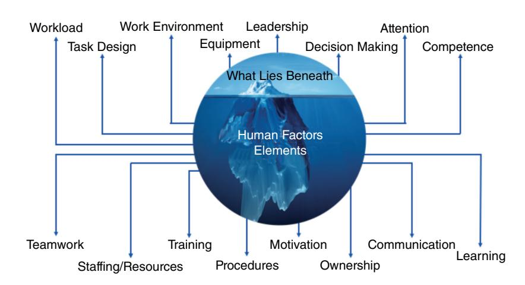

## **7.2 Participant Demographics for SPE Getting to Zero: The Road to Stavanger Sessions**

SPE Getting to Zero: The Road to Stavanger sessions conducted across the globe were attended by more than 750 participants. During the interactive sessions, participants were asked to report their organizational affiliation and their employment position. The results are illustrated by the graphs below.

**Fig. 9—Organizational affiliation of participants of the SPE Getting to Zero sessions.**

**Fig. 10—Employment positions of participants of the SPE Getting to Zero sessions.**

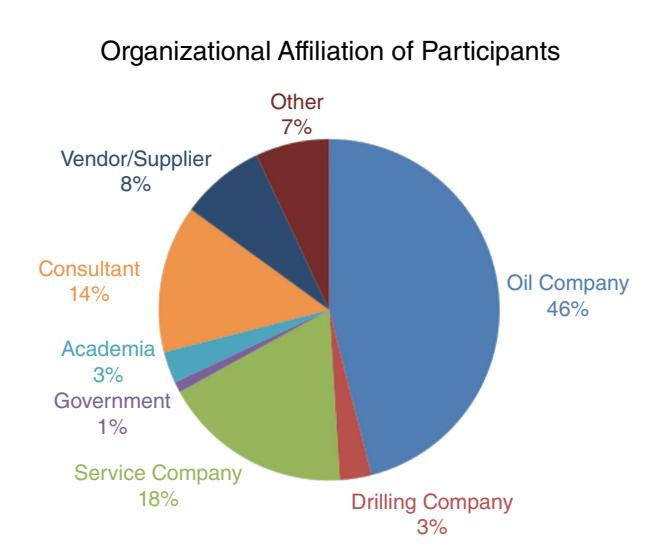

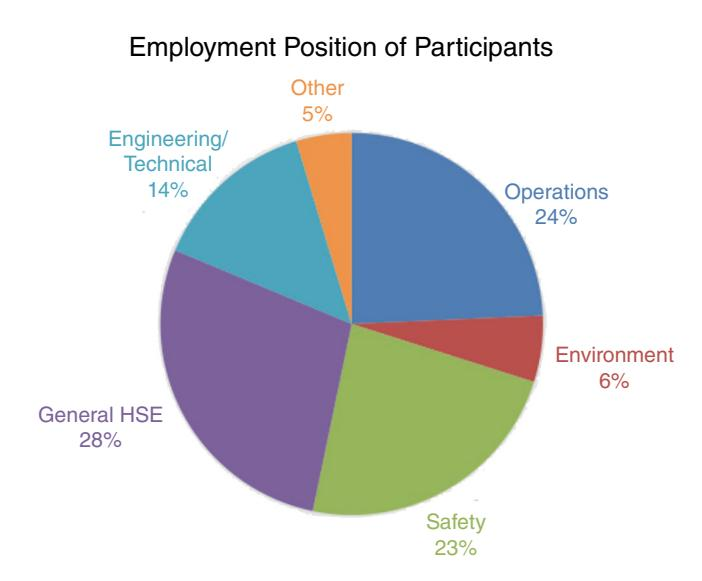

# **SPE Technical Report**

Society of Petroleum Engineers

222 Palisades Creek Dr.,

Richardson, TX 75080-2040

972-952-9393

www.SPE.org 2018

# **SAJAA 9 Coil Tubing Underbalanced Drilling**

January 2006 End of Well Report

- Revision: 2 Date: 23rd February 2006 Prepared by: R. Pickles
  - J. Rennox
  - T. Kavanagh
- P. Savage Prepared for: bp Sharjah Oil Company

## **Sajaa 9 - Coiled Tubing Acid Job (Summary) - 1998**

The coiled tubing acid job work was done in February 1998. The purpose of the work was to remove OBM and stimulate both laterals as well as testing the re-entry capability of the Baker Lateral Entry Nipple (LEN) system.

From the IP standpoint this has been ASOC's most successful coil tubing stimulation to date. Possible reasons include concentrating the acid in the porous and naturally fractured intervals, acidizing the well while SI which allows the spent acid head to help "squeeze" the acid into the target zones. A 4 to 5 MMCFD initial production increase was realized.

Summary of runs:

9a

- 2-3/8" dummy run to 14,813' flooded with diesel and ran to 15,971' with stick/slip last 1100'
- After flowing to recover diesel and spotting xylene CT became stuck
- Pulling and working pipe unsuccessful, pumped 100 BBL acid and all pulled free
- Acidized 15,600' 14,800' , 13,700' 11,850'
- Cleanup recovered mud/acid insolubles

9b

- Len ID too small for 2-3/8" CT with diverter installed
- Installed CT diverter on slick line
- RIH and stacked out on something
- Due to unresolved technical challenges, aborted job
- "A' acid job increased productivity by + 5 MMCFD

## **Sharjah Historical Intervention Tracking sheet**

## **Well: Sajaa 09**

11.Feb.98 CT RIH with 2.3/8" coil to 15,890ft. (CT) in leg A and pump xylene and foamed acid. 15.Feb.98 W/L ran whipstock and set in LEN. 16.Feb.98 CT make dummy run with 2" CT into upper leg B. Hung up at 11,307ft (CT). Abandoned run. Wireline pulled whipstock. 06.Nov.01 As a precaution, cellar dug out, shims installed to support 20" csg. and cellar reconcreted. 17.Nov.02 Check valve and choke replaced with manual gate valve and flow tee. 18.Nov.02 Ran 3.42" GC to 11,512'rkb. No obstructions or anomalies found. 25.Nov.02 Ran PSP to 11,450ftrkb HUD. Flow was 72% from Shuaiba and 28% from Kharaib. During SI pass cross-flow was shown from the Shuaiba to the Kharaib. Max. BHT was 276 degrees F. 29.Nov.05 Ran 3.6" GC to 11,287ft rkb. Ran 2.5" GC to 11,511ft rkb. Couldn't get 2.75" GC passed 11,294ft rkb.

## **NPT Analysis**

NPT for Sajaa 9 was 8.2% of total time and 5.1% of total cost. This is the 3rd lowest NPT time and 4th lowest NPT cost since the start of the project.

| Totals       | Time [Hours] | Cost        | % of Total Time | % of Total Cost |
|--------------|--------------|-------------|-----------------|-----------------|
| Baker        | 27.40        | \$131,424   | 6.3%            | 4.4%            |
| bp           | 0.00         | \$0         | 0.0%            | 0.0%            |
| GSI          | 1.00         | \$4,136     | 0.2%            | 0.1%            |
| Halliburton  | 0.58         | \$2,399     | 0.1%            | 0.1%            |
| Schlumberger | 2.16         | \$12,909    | 0.5%            | 0.4%            |
| SEAL         | 0.00         | \$0         | 0.0%            | 0.0%            |
| Misc/Weather | 0.00         | \$0         | 0.0%            | 0.0%            |
| Al Faris     | 4.17         | \$2,710     | 1.0%            | 0.1%            |
| Total NPT    | 35.31        | \$153,578   | 8.2%            | 5.2%            |
| Total Well   | 432.00       | \$2,971,485 |                 |                 |
| Productive   | 396.69       | \$2,820,617 | 91.8%           | 94.9%           |

Rig Days 18.0 Days

Every failure of a BHA was recorded as NPT against Baker (NB: this includes BHI & BOT) as per bp standard procedure, to remove any subjectivity from the appliance of NPT criteria. However, bp considers the use of 2 milling BHA's per window (1 to run Whipstock and one to mill the window) and 1 drilling BHA per leg as a reasonable technical limit for this project, given the down hole temperatures and drilling fluid pumped. Accordingly, the NPT for Baker using these criteria would have been reduced to:

| Totals       | Time         |       |             |            |
|--------------|--------------|-------|-------------|------------|
|              |              | Cost  | % of Total  |            |
|              | Totals       | Time  |             |            |
|              |              |       | Cost        | % of Total |
| bp           | Baker        | 3.9   | \$18,775    | 0.9%       |
| GSI          | bp           | 0.0   | \$0         | 0.0%       |
| Halliburton  | GSI          | 1.0   | \$4,136     | 0.2%       |
| Schlumberger | Halliburton  | 0.6   | \$2,399     | 0.1%       |
| SEAL         | Schlumberger | 2.2   | \$12,909    | 0.5%       |
| Undefined    | SEAL         | 0.0   | \$0         | 0.0%       |
| Al Faris     | Undefined    | 0.0   | \$0         | 0.0%       |
| Total NPT    | Al Faris     | 4.2   | \$0         | 1.0%       |
| Total Well   | Total NPT    | 7.7   | \$38,219    | 1.8%       |
| Productive   | Total Well   | 432.0 | \$2,971,485 |            |

## **NPT Time Breakdown:**

| BAKER  |       |                      |            |           |
|--------|-------|----------------------|------------|-----------|
| Date   | Time  | Problem              | Daily Cost | NPT cost  |
| 11-Jan | 14.07 | Orienter failure     | \$106,441  | \$62,401  |
| 11-Jan | 6.91  | GR tool failure      | \$106,441  | \$30,646  |
| 12-Jan | 6.00  | Orienter failure     | \$143,465  | \$35,866  |
| 12-Jan | 0.42  | Re-boot BHI computer | \$143,465  | \$2,511   |
| Totals | 27.40 |                      | Dollars    | \$131,424 |

| SLB    |      |                                                    |            |          |
|--------|------|----------------------------------------------------|------------|----------|
| Date   | Time | Problem                                            | Daily Cost | NPT cost |
| 01-Jan | 1.24 | Volvo Powerpack air compressor head gasket         |            |          |
|        |      | blown - replace.                                   |            |          |
|        |      |                                                    | \$134,955  | \$6,973  |
| 09-Jan | 0.50 | CCAT crash.                                        | \$154,861  | \$3,226  |
| 12-Jan | 0.42 | Friction wheel slipping, switch to UTLM and re-log |            |          |
|        |      | section.                                           | \$154,861  | \$2,710  |
| Totals | 2.16 |                                                    | Dollars    | \$12,909 |

| GSI    |      |                                                  |            |          |
|--------|------|--------------------------------------------------|------------|----------|
| Date   | Time | Problem                                          | Daily Cost | NPT cost |
| 14-Jan | 1.00 | Manual dump valve from scrubber opened in error. | \$99,264   | \$4,136  |
| Totals | 1.00 |                                                  | Dollars    | \$4,136  |

| HES    |      |                          |            |          |
|--------|------|--------------------------|------------|----------|
| Date   | Time | Problem                  | Daily Cost | NPT cost |
| 14-Jan | 0.58 | Condensate pump problems | \$99,264   | \$2,399  |
| Totals | 0.58 |                          | Dollars    | \$2,399  |

# **Appendices**

## **Appendix 1: HSE Statistics**

## Environmental Totals

12.60% Hydrocarbon gas flared on this well. 23,994 man-hours worked on Sajaa #9 without a DAFWC. 1,193,143 man-hours without a DAFWC for the entire project thus far. Sajaa 9 - End Of Well Report

| 5.25” ID, top @ |           |        |             |           |                        |      |       |      |
|-----------------|-----------|--------|-------------|-----------|------------------------|------|-------|------|
|                 |           |        |             |           |                        | GN  |       |      |
|                 |           |        |             |           |                        |      | H 2 S |      |
|                 | Job Date  | Job ID | Client Name | Well Name | Job Description        |      |       | CO 2 |
| 18              | 11-Jan-06 | BHA 6  | BP          | Sajaa 09  | Drill Leg 4C - Fail    | 100  | 40    | 4    |
| 19              | 11-Jan-06 | BHA 7  | BP          | Sajaa 09  | Drill Leg 4C           | 100  | 40    | 4    |
| 20              | 14-Jan-06 |        | BP          | Sajaa 09  | cut 15ft CT & 15 cable |      |       |      |

#### **Coiled Tubing Fatigue Life Plot for PE 12289** Leg 3E @

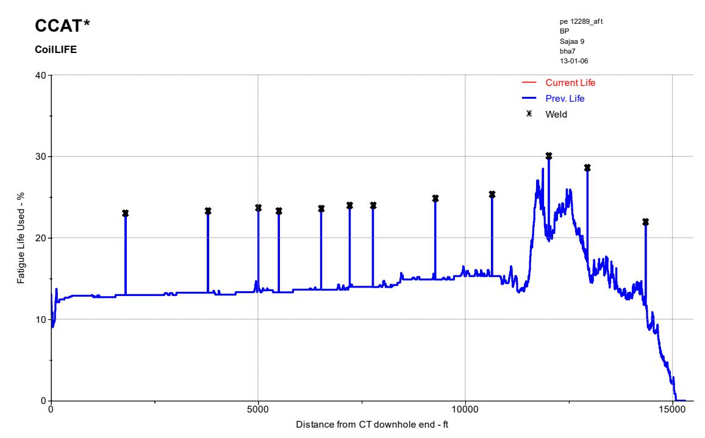

**© Schlumberger 1994-2005**

